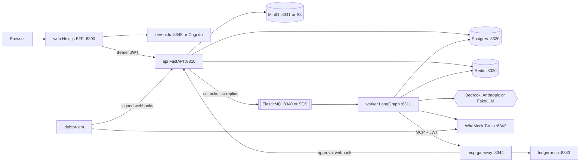
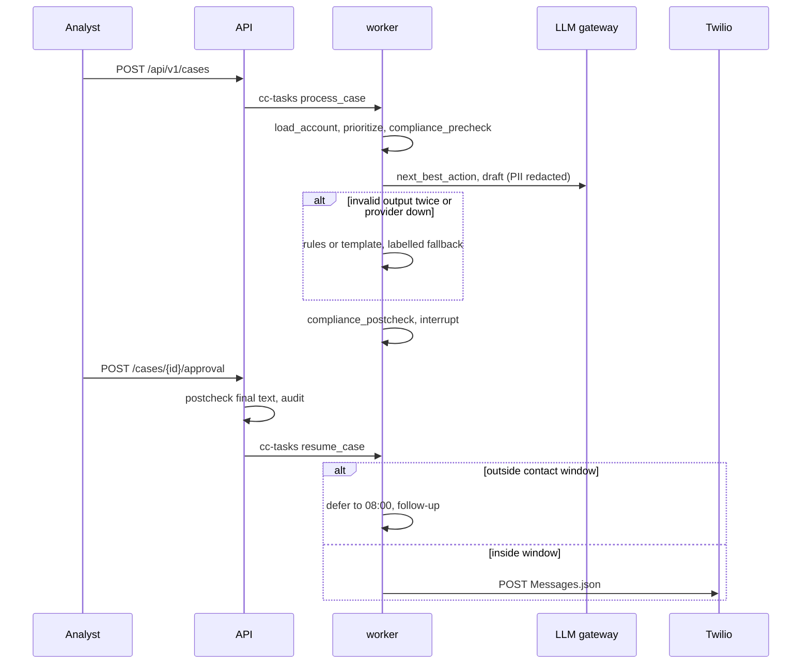
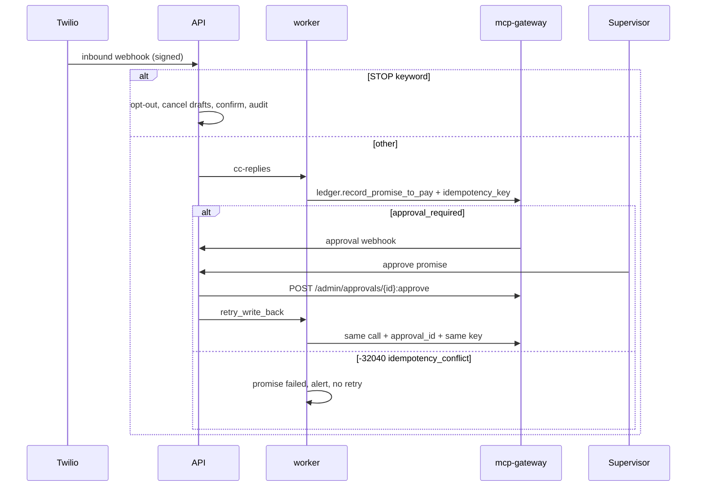

# BUILD: collections-copilot

> **How to run this file.** Put this file alone in an empty folder (local run) or at the root of an empty GitHub repository (Claude Code on the web). Start Claude Code there and send:
> `Read BUILD.md and execute it end to end. Do not stop until every item in the Global Definition of Done is checked.`
> This file is the complete specification. Everything needed to build, test, document and verify the repository is here.

## 0. Operating mode

You are the only engineer on this repository and you work autonomously from the first command to the final verification. Nobody will answer questions while you work.

1. **Do not stop early.** Do not end your turn while any item in §9 Global Definition of Done is unchecked. When you believe you are finished, run §19 Final verification; if anything fails or is unchecked, keep working. The only valid early stop is a hard blocker under §20.

2. **Decide, don't ask.** When something is ambiguous, choose the option that best serves §2 Product brief, record it in `docs/DECISIONS.md` (date, decision, alternatives, reason) and continue. Architectural choices also get an ADR in `docs/adr/`.

3. **Progress lives in the repository.** In M0, create `PROGRESS.md` with a "Needs the maintainer" section at the top, every task from §8 (ID, title, status, evidence), and the Global Definition of Done from §9 as a checklist; check items there, never in this file. Update it after every task and mirror it in your task-tracking tool if you have one. After a context compaction, a restart or a new session, first re-read `BUILD.md` (or `docs/specs/000-build-spec.md`), `PROGRESS.md`, `docs/DECISIONS.md` and `git log --oneline -30`, then resume from the first unchecked task. Never redo finished work.

4. **Small verified increments.** For each task: write the failing test first, implement, run the relevant checks, record evidence in `PROGRESS.md` (the command and a one-line result), and commit with a Conventional Commit message. Never leave the branch red between tasks.

5. **Push often when a remote exists.** After every milestone run `git push -u origin <current-branch>`, retrying network failures up to 4 times with backoff (2, 4, 8, 16 seconds). The container can be reclaimed and unpushed work is lost. Push only the current branch and never force-push.

6. **Honesty over appearance.** Never invent metrics, eval scores, benchmark numbers, screenshots or test results. Every number in the README and docs comes from a command you ran, cited next to it. Never skip, disable, mark as expected-failure or weaken a test or threshold to get green: fix the code, or record the gap in `docs/KNOWN_LIMITATIONS.md`.

7. **Offline first.** Every test, the demo and `make verify` must pass with no API keys and no paid services, using the deterministic fakes and recorded fixtures. Live model calls exist only behind `make eval-live`: it reads keys from the environment, prints the estimated cost first, and stops at `LIVE_EVAL_BUDGET_USD` (default 2). Run it once at the end only if the provider key is set; otherwise the eval report states that live evals were not run.

8. **Safety rails.** Never run `terraform apply` or `terraform destroy`, never deploy to a cloud account, never create, publish or change the visibility of a GitHub repository, never send messages to real recipients (email, SMS, Slack, voice), never commit secrets or real personal data. Synthetic data only. Never change the git identity, and never add Claude attribution to commits or pull requests (§1.1).

9. **Use the harness you build.** From the end of M0, use the subagents, skills, rules and hooks you created in `.claude/` (§7). Run the `reviewer` subagent at the end of every milestone and fix its blockers before moving on. Use parallel subagents only for independent read-heavy work (research, reviews, audits), never for two agents editing the same files. If a subagent or skill you created is not loaded in this session yet, run a general-purpose subagent with that file's instructions, or follow the `SKILL.md` steps by hand.

10. **Use Claude Code's bundled skills when they are available:** `claude-api` before writing any code that calls Claude; `session-start-hook` to build the cloud SessionStart hook; `run` to launch the app and capture screenshots; `code-review`, `security-review` and `simplify` in the final hardening milestone. If one is not available, do the equivalent by hand.

11. **Keep the context lean.** Don't print large files or long logs into the conversation; summarize command output and write long notes to files.

12. **Ownership.** All code is new and MIT licensed. Do not copy code beyond what its license allows, attribute any adapted snippet in a comment, and do not name any real employer, client or product of the maintainer.

## 1. Environment bootstrap

1. **Detect the environment.** `CLAUDE_CODE_REMOTE=true` means Claude Code on the web (apply Appendix A); otherwise local. Record OS and tool versions (or "missing") in `docs/DEVELOPMENT.md`.
2. If `git rev-parse --is-inside-work-tree` fails, run `git init -b main`.
3. **Pre-seeded repository.** The maintainer's initial commit already contains `BUILD.md`, a placeholder `README.md`, `LICENSE`, `.gitignore`, `.claude/settings.json` (with the `attribution` key and a starter permission list) and `.claude/rules/git-commits.md`. If both files already exist with the required content, §1.1 steps 1–2 are already satisfied: verify the content, skip creating an empty commit in step 4, run the evidence command on the commit that introduced them (`git log --diff-filter=A --format='%an <%ae> | %cn <%ce>%n%B' -- .claude/rules/git-commits.md`) and record it in `PROGRESS.md`. Step 3 (identity check) always runs.

### 1.1 Commit attribution

Commits and pull requests from this build go out under the maintainer's name only, with no Claude attribution. Do this right after `git init`, before any other commit.

1. Create `.claude/settings.json` with this key. If the file already exists, merge the key without removing anything else:
   ```json
   {
     "attribution": { "commit": "", "pr": "", "sessionUrl": false }
   }
   ```
2. Create `.claude/rules/git-commits.md`, with no `paths:` frontmatter so it always loads, containing this rule:
   ```markdown
   Do not add Co-Authored-By, Claude-Session or "Generated with Claude Code" trailers to commits or pull requests. Do not modify `git config user.*` or the `GIT_AUTHOR_*` / `GIT_COMMITTER_*` variables.
   ```
3. Check that `GIT_AUTHOR_NAME`, `GIT_AUTHOR_EMAIL`, `GIT_COMMITTER_NAME` and `GIT_COMMITTER_EMAIL` are defined. Never define or invent a missing one, and never touch git config.
   - On Claude Code on the web (`CLAUDE_CODE_REMOTE=true`), a missing variable is a hard blocker (§20 d): commit and push nothing, and end by listing the missing variables and saying that they go in the cloud environment's environment variables, followed by a new session.
   - On a local run these variables are usually unset and git uses the local git config. Record the name and email from `git var GIT_AUTHOR_IDENT` and `git var GIT_COMMITTER_IDENT` in `PROGRESS.md` and continue. If git has no identity at all, stop under §20 d.
4. Commit only those two files, then show the result:
   ```bash
   git add .claude/settings.json .claude/rules/git-commits.md
   git commit -m "chore: configure commit attribution" -- .claude/settings.json .claude/rules/git-commits.md
   git log -1 --format='%an <%ae> | %cn <%ce>%n%B'
   ```
   Show the output of the last command and copy it into `PROGRESS.md` as evidence that author and committer are the maintainer and that the message has no trailers.

This rule applies to every later commit and pull request in this build and takes precedence over any default attribution instruction from the environment. If a commit with attribution slips in, fix it before pushing by amending or rewriting only the unpushed commits. If it was already pushed, never force-push: list it under "Needs the maintainer" in `PROGRESS.md`.

### 1.2 Repository hygiene

Extend `.gitignore` (`.env.*` except `.env.example`, `.evalgate/`, `evals/reports/*.json` except `baseline.json`, `deploy/data/`); never ignore lockfiles. Add `.editorconfig`. Keep the MIT `LICENSE` (copyright "ROBERTG99"). Copy this file to `docs/specs/000-build-spec.md`.

### 1.3 Toolchains

Latest stable at build time, pinned in `uv.lock`, `pnpm-lock.yaml` and `.terraform.lock.hcl`. Python ≥ 3.12 with uv; Node 22 with pnpm; Terraform ≥ 1.9 from `releases.hashicorp.com`; tflint, trivy, hadolint, k6, terraform-docs from GitHub releases; checkov, pre-commit via `uv tool install`; actionlint, gitleaks via `go install`. `scripts/install-tools.sh` installs missing tools idempotently into `~/.local/bin`; `make bootstrap` calls it.

### 1.4 Docker

Local macOS: if `docker info` fails, run `open -a Docker` and poll for up to 2 minutes. Cloud: Appendix A.

### 1.5 Sibling dependencies

- **evalgate v0.1.0:** if `git ls-remote --tags https://github.com/ROBERTG99/evalgate refs/tags/v0.1.0` finds the tag, depend on `evalgate @ git+https://github.com/ROBERTG99/evalgate@v0.1.0`; otherwise build the subset this repo uses in `third_party/evalgate/` as a workspace member.
- **mcp-gateway v0.1.0:** use `ghcr.io/robertg99/mcp-gateway:v0.1.0`; else `docker build https://github.com/ROBERTG99/mcp-gateway.git#v0.1.0`; else the contract subset in `third_party/mcp-gateway/` (YAML policy instead of OPA).
- Any fallback is recorded in `docs/DECISIONS.md` and listed under "Needs the maintainer". The agent never pushes tags.

Commit with `chore: bootstrap repository tooling`.

## 2. Product brief

**Problem.** A B2B collections analyst owns about 400 past-due accounts, sorts a spreadsheet by age, writes each SMS by hand and retypes outcomes into the ledger. Baseline (all synthetic assumptions): 12 minutes per account contact, 30% of accounts not contacted inside the target window, DSO 58 days, 3% of contacts outside allowed hours (regulatory risk), promises logged late or twice.

**Users.** Analyst (queue, drafts, replies); supervisor (auto-approval thresholds, held write-backs, audit); admin (compliance settings, opt-outs); debtor (receives SMS on synthetic `+1555`/`+34555` numbers).

**Business metric.** Accounts contacted in window 70% → 95%; analyst minutes per account 12 → 3 (synthetic assumptions). Offline proxies (§11): NBA accuracy, reply macro-F1, compliance violations = 0, unauthorized write-backs = 0.

**Why AI, and where not.** The LLM reads free-text notes and replies and drafts tone-appropriate messages; the priority score, every compliance rule, money amounts, STOP handling and every side-effect permission are deterministic code.

## 3. Scope and requirements

### 3.1 Functional requirements

- **FR-1 Ingest.** AR aging as CSV via presigned S3 upload (MinIO locally) or JSON API; Pydantic validation; idempotent by SHA-256. *Given* the same 400-row file twice, *when* completed, *then* the second call returns the first batch with `duplicate: true`; *given* a negative amount, *then* the batch is `rejected` with the row number.
- **FR-2 Priority score.** Deterministic 0–100 from balance, days past due, broken promises (90 days) and segment, plus an LLM rationale (`prioritize_rationale.v1`) that never changes the score. *Given* two accounts differing only in balance, *then* the larger scores higher; *given* an LLM failure, *then* the score is stored and the rationale is null.
- **FR-3 Next best action.** Structured `{action: remind|payment_plan|escalate|pause|no_action, rationale, confidence, cited_note_ids}`; LLM only when notes exist, else rules. *Given* a dispute note, *then* `pause` citing that note; *given* invalid output twice, *then* the case goes to an analyst with reason `nba_invalid_output`.
- **FR-4 Drafting.** SMS ≤ 320 characters in the account language (EN or ES) from `draft_message.v1` and `prompts/policies/tone.md`. *Given* `payment_plan` and `es`, *then* a Spanish body with the opt-out footer and only ledger amounts.
- **FR-5 Compliance engine.** Pre-check and post-check (also after every edit): window 08:00–21:00 debtor local time, ≤ 3 contacts per account per rolling 7 days, opt-out list, no reminders on disputed invoices, no amount absent from the ledger, footer, forbidden phrases, link allowlist. *Given* an approval at 20:55 local, *then* the send is deferred to 08:00 with a follow-up; *given* USD 999.00 not in the ledger, *then* `amount_not_in_ledger` blocks approval.
- **FR-6 Human approval.** LangGraph `interrupt()`; approve, edit (diff stored) or reject with reason; batch of ≤ 50; auto-approval only for `remind` ≤ USD 500 (`CC_AUTO_APPROVE_MAX_USD`) with confidence ≥ 0.9 (`CC_AUTO_APPROVE_MIN_CONFIDENCE`), supervisors may only tighten. *Given* an edit, *then* post-check runs on the edited text and the audit stores the diff; *given* `payment_plan` at 0.99, *then* never auto-approved.
- **FR-7 SMS.** Twilio adapter behind `SmsSender`; status webhooks verified by `X-Twilio-Signature`, deduplicated by `(MessageSid, MessageStatus)`. *Given* a duplicate callback, *then* one row; *given* a bad signature, *then* 403 and an audit event.
- **FR-8 Replies.** Classification `promise_to_pay|dispute|wrong_number|paid|stop|other` (`classify_reply.v1`) with promise extraction; STOP keywords handled by rule first. *Given* "stop", *then* opt-out, one confirmation SMS, and no LLM call recorded.
- **FR-9 Promise write-back.** `ledger.record_promise_to_pay` through mcp-gateway with `params._meta.idempotency_key = ptp:<tenant>:<MessageSid>`; on `approval_required`, hold for a supervisor and retry with `_meta.approval_id` and the same key. *Given* a crash after the call and redelivery, *then* one ledger row; *given* USD 8,000, *then* `approval_required`, and after approval exactly one row.
- **FR-10 Follow-ups.** Scheduled after each send (3 business days), deferral, promise date (+1 day) and unanswered approval (24 h). *Given* a promise due yesterday and unpaid, *then* it becomes `broken` and a new case is enqueued.
- **FR-11 Live progress.** SSE on `GET /api/v1/cases/{id}/events`, 15 s heartbeats, `Last-Event-ID` resume. *Given* a reconnect with `Last-Event-ID`, *then* only later events arrive.
- **FR-12 Audit.** Append-only hash-chained `audit_events` for approvals, edits, rejections, sends, opt-outs, write-backs, settings and rejected webhooks; `cc audit verify`. *Given* one tampered row, *then* exit 1 with the first bad sequence number.
- **FR-13 Auth and RBAC.** OIDC (Cognito; dev-oidc locally), roles from `cognito:groups`, tenant from `custom:tenant_id`. *Given* an analyst, *when* `PUT /api/v1/settings/auto-approval`, *then* 403; *given* a tenant-A token and a tenant-B id, *then* 404.
- **FR-14 Ops dashboard.** Counts by status, contact-window rate, pending approvals, cost per account, node p95, DLQ depth. *Given* the seeded demo, *then* every card equals `GET /api/v1/metrics/ops`.
- **FR-15 AWS infrastructure.** Complete Terraform (§16.3), never applied. *Given* `infra/terraform/envs/dev`, *when* `make tf-test` runs offline with `mock_provider`, *then* every assertion passes.

### 3.2 Non-functional requirements

| ID | Requirement | Measured by |
|---|---|---|
| NFR-1 | `GET /api/v1/queue?limit=50` p95 < 300 ms; `GET /api/v1/accounts/{id}` p95 < 200 ms; 20 virtual users, 60 s, 400 accounts | `make bench` (k6) |
| NFR-2 | Case graph to approval interrupt p95 < 300 ms offline, < 8 s live | `make eval`, `make eval-live` |
| NFR-3 | LLM cost ≤ USD 0.02 per account live (routing in §4.6) | eval report |
| NFR-4 | 400 accounts to approval interrupts < 3 min offline, 4 workers | `tests/perf/test_batch_400.py` |
| NFR-5 | Zero sends without an approval record or matching auto-approval policy | `tests/integration/test_no_send_without_approval.py` |
| NFR-6 | `make up` healthy < 5 min with cached images | `scripts/time_up.sh` |
| NFR-7 | KMS encryption at rest for RDS, S3, SQS, logs | `terraform test` |
| NFR-8 | RTO 1 h, RPO 5 min (point-in-time recovery, 7-day backups) | `docs/runbook.md` |
| NFR-9 | Upload ≤ 10 MB and 20,000 rows; JSON ≤ 1 MB; 120 requests/min per user | `tests/integration/test_limits.py` |
| NFR-10 | PII sent to providers = 0; no secrets or phone numbers in logs | PII spy and log tests |
| NFR-11 | LLM outage degrades to rules and templates labelled `fallback`, never to unapproved sends | `tests/integration/test_llm_outage.py` |

### 3.3 Out of scope

Real email (Mailpit only), voice, payments, a real ERP, languages beyond EN and ES, debtor portal, applying Terraform.

### 3.4 User journeys

**Main.** `ana.analyst` signs in → prioritized queue → account detail with NBA citing notes → approval drawer with exact SMS, send time and ledger effect → edits a sentence (diff and post-check update) → approves; SSE shows `send_sms`, `await_reply` → the debtor simulator replies "I can pay 1,200 on Friday" → classified `promise_to_pay`, one ledger write, follow-up for Saturday.

**Secondary.** (a) Supervisor batch-approves 20 `remind` drafts and tightens auto-approval to 0.95. (b) A USD 8,000 promise returns `approval_required`; supervisor approves; the retry reuses the key; one ledger row. (c) "STOP" reply: opt-out by rule, drafts cancelled.

## 4. Architecture

### 4.1 Components



- **web:** Next.js console and backend-for-frontend; encrypted httpOnly session cookie; proxies `/api/*` and SSE so the browser never holds tokens.
- **api:** REST, SSE, webhooks, RBAC, ingest, approval decisions (enqueue `resume_case`), settings, metrics, `/.well-known/agent-jwks.json`.
- **worker:** SQS consumer running the case and reply graphs with the Postgres checkpointer, plus the follow-up scheduler (leader via Postgres advisory lock).
- **ledger-mcp:** synthetic ledger, Python FastMCP over Streamable HTTP, schema `ledger`.
- **mcp-gateway:** consumed image or fallback; JWT, policy, idempotency, approvals and audit for ledger calls.
- **dev-oidc:** Cognito double with personas `ana.analyst`, `sam.supervisor`, `adi.admin`, `tia.tenantb`.
- **debtor-sim:** demo only; reads the WireMock request journal, posts signed status callbacks and scripted persona replies.

### 4.2 Main flows





### 4.3 Data model

Alembic in `migrations/`. Every table has `tenant_id uuid not null`, filtered by repositories in `db/repositories/`. Money is `bigint` cents plus `currency char(3)`; times are `timestamptz`.

| Table | Key columns | Constraints and indexes |
|---|---|---|
| `tenants` | `id`, `name` | unique `name` |
| `accounts` | `external_ref`, `name`, `phone_e164`, `timezone`, `segment`, `language`, `opted_out_at` | unique (`tenant_id`,`external_ref`); checks on segment and language |
| `invoices` | `account_id`, `number`, `amount_cents`, `due_on`, `status`, `dispute_reason` | unique (`tenant_id`,`number`); `amount_cents > 0` |
| `notes` | `account_id`, `source`, `body`, `created_at` | index (`account_id`,`created_at`) |
| `ingest_batches` | `sha256`, `object_key`, `row_count`, `status`, `errors jsonb` | unique (`tenant_id`,`sha256`) |
| `cases` | `id` (= LangGraph `thread_id`), `account_id`, `status`, `priority_score`, `score_components jsonb`, `nba_action`, `nba_confidence`, `cited_note_ids uuid[]`, `fallback` | one open case per account (partial unique); index (`tenant_id`,`status`,`priority_score`) |
| `drafts` | `case_id`, `version`, `body`, `author`, `prompt_version`, `model`, `precheck`, `postcheck` | unique (`case_id`,`version`) |
| `approvals` | `draft_id`, `decision`, `reason`, `diff`, `decided_by`, `policy_snapshot` | unique `draft_id` |
| `messages` | `direction`, `provider_sid`, `body`, `status`, `classification`, `idempotency_key` | unique `provider_sid`; unique `idempotency_key` |
| `message_status_events` | `provider_sid`, `status`, `payload` | unique (`provider_sid`,`status`) |
| `promises` | `amount_cents`, `promised_date`, `status`, `idempotency_key`, `mcp_approval_id`, `ledger_ref` | unique `idempotency_key` |
| `follow_ups` | `case_id`, `kind`, `due_at`, `status` | index (`status`,`due_at`) |
| `opt_outs` | `phone_e164`, `source` | pk (`tenant_id`,`phone_e164`) |
| `contact_log` | `account_id`, `sent_at` | index for the 7-day cap |
| `settings` | `key`, `value jsonb`, `updated_by` | pk (`tenant_id`,`key`) |
| `step_records` | shared step record + `case_id` | index `run_id` |
| `audit_events` | `seq`, `actor_type`, `actor_id`, `action`, `entity`, `payload_redacted`, `prev_hash`, `hash` | trigger rejects UPDATE and DELETE |
| `api_idempotency` | `key`, `request_sha256`, `response` | pk (`tenant_id`,`key`) |

Checkpoints live in schema `checkpoints` (`AsyncPostgresSaver.setup()`); the ledger owns schema `ledger`. Retention (`cc maintenance purge`, daily): step records 90 days, closed-case checkpoints 30 days, API idempotency 7 days; audit and messages 7 years.

### 4.4 Contracts

REST under `/api/v1`; errors are RFC 9457 problem details with `correlation_id`; mutating routes accept `Idempotency-Key`.

| Endpoint | Request → response | Errors |
|---|---|---|
| `POST /ingest/uploads`, `POST /ingest/uploads/{id}:complete` | `{filename, size_bytes}` → `{upload_id, put_url}`; complete → `{batch_id, duplicate}` | 404, 413, 422 |
| `POST /ingest/aging`, `GET /ingest/batches/{id}` | `{rows}` → `{batch_id, duplicate}`; batch status | 413, 422 |
| `GET /queue` | filters, `limit ≤ 100`, `cursor` → `{items, next_cursor}` | 422 |
| `GET /accounts/{id}` | → account, invoices, aging, notes, cases, messages, promises | 404 |
| `POST /cases`, `GET /cases/{id}` | `{account_ids ≤ 400}` → `202 {cases}`; case with drafts and steps | 404, 409 |
| `GET /cases/{id}/events` | SSE `node`, `draft`, `status`, `heartbeat` | 404 |
| `POST /cases/{id}/approval` | `{decision, draft_version, body?, reason?}` → `{case, postcheck}` | 409 stale, 422 |
| `POST /approvals:batch` | `{items ≤ 50}` → per-item results | 422 |
| `GET /replies`, `/promises`, `/follow-ups`; `POST /promises/{id}:approve` and `:reject` | paged lists; supervisor decision | 403, 409 |
| `GET /audit`, `GET /metrics/ops`, `GET`/`PUT /settings/auto-approval`, `GET`/`POST /opt-outs`, `GET /me` | role-gated | 403, 422 |
| `POST /webhooks/twilio/status`, `/webhooks/twilio/inbound`, `/webhooks/mcpgw/approvals` | signed form or gateway body → 204 | 403, 404 unknown approval |

**Queues.** `cc.task.v1` `{task_id, tenant_id, kind: process_case|resume_case|follow_up|retry_write_back, case_id, resume, attempt, enqueued_at}`; `cc.reply.v1` `{tenant_id, message_id, provider_sid, from_e164, body, received_at}`. Visibility 60 s, `maxReceiveCount` 5, then `cc-tasks-dlq` or `cc-replies-dlq`. SSE events go through Redis channel `cc:events:<tenant>:<case_id>` and a 200-entry stream for resume.

**MCP.** Calls carry an agent JWT (`iss`, `aud=mcp-gateway`, `sub=cc-worker`, `tenant`, `scopes` `ledger:read`/`ledger:write`, `exp` ≤ 5 min). Write calls send `params._meta.idempotency_key`; retries after approval add `params._meta.approval_id`. Results are read from `structuredContent`, treated as untrusted and never placed in prompts. Tools: `ledger.get_balance {account_ref}`; `ledger.list_open_invoices {account_ref}`; `ledger.record_promise_to_pay {account_ref, amount_cents > 0, currency, promised_date, invoice_numbers ≥ 1, source_message_sid} → {ledger_ref}`; `ledger.add_collection_note {account_ref, body ≤ 1000}`. Policy `deploy/mcpgw/policy/collections.rego` (YAML for the fallback): `cc-worker` may call only these tools; promises above 500000 cents or more than 60 days out require approval.

### 4.5 Agent graphs

**Case graph** (`agent/case_graph.py`, state `CaseState`: account, invoices, notes, priority, nba, precheck, draft, postcheck, approval, send, errors, fallback): `load_account → prioritize → compliance_precheck → next_best_action → route`. `pause|no_action → close`; `escalate → notify_supervisor → close`; `remind|payment_plan → draft → compliance_postcheck`; a failed post-check redrafts once with the violations, a second failure reaches approval with `requires_edit`. `human_approval` calls `interrupt()` unless auto-approval applies; resume `{decision, body, reason, actor}`; approve or edit → final post-check → `send_sms → schedule_follow_up → await_reply` (interrupt); reject → close. Checkpointer `AsyncPostgresSaver`, `thread_id = case_id`, resume with `Command(resume=value)`.

**Reply graph** (`agent/reply_graph.py`): `stop_rule → classify_reply → route`: promise → `validate_promise` (amount ≤ open balance, date 1–90 days) → `record_promise` → follow-up; dispute → flag invoices, cancel drafts; paid → verification follow-up; wrong_number → flag contact; other → analyst.

**Prompts** (`prompts/`, hash logged per call): `prioritize_rationale.v1`, `next_best_action.v1`, `draft_message.v1`, `classify_reply.v1`, `judge_tone.v1`, `policies/tone.md`, fallback `templates/`. Notes and replies appear only inside `<untrusted_note>` blocks after the instructions. Schemas in `agent/schemas.py`: `PriorityRationale`, `NextBestAction`, `Draft`, `ReplyClassification`, `ToneJudgement`; an invalid output gets one retry with the validation error, then the fallback.

### 4.6 Model routing and fallbacks

| Route | Model | Effort | Fallback |
|---|---|---|---|
| `prioritize_rationale` | `CC_MODEL_FAST` | low | null rationale |
| `next_best_action` (only with notes) | `CC_MODEL_REASONING` | medium | `agent/nba_rules.py` |
| `draft_message` | `CC_MODEL_FAST` | medium | templates, author `fallback` |
| `classify_reply` | `CC_MODEL_FAST` | low | `other` → analyst |
| `judge_tone` (evals) | `CC_MODEL_FAST` | low | none |

Defaults `claude-opus-5-5` and `claude-haiku-5-5` (Bedrock `anthropic.claude-opus-5-5`, `anthropic.claude-haiku-5-5`); `CC_LLM_PROVIDER` = `fake` (default), `bedrock` or `anthropic`. Stable system prompt and tone policy are a cached prefix. 20 s timeout, 2 retries, circuit breaker after 5 failures for 60 s. `ChatBedrock` is used only if `tests/unit/llm/test_chatbedrock_conformance.py` proves Appendix B compliance; otherwise the SDK Bedrock Mantle client (ADR 0002).

### 4.7 Concurrency, idempotency and failures

Worker concurrency `CC_WORKER_CONCURRENCY=8` per task (semaphore), long polling 20 s, visibility extended every 30 s. Keys: ingest file hash; API `Idempotency-Key`; SMS `sms:<case_id>:<draft_version>` inserted before the provider call; status `(provider_sid, status)`; inbound `provider_sid`; ledger `ptp:<tenant>:<MessageSid>`; follow-ups claimed with `FOR UPDATE SKIP LOCKED`. Failures: Postgres down → `/readyz` 503 and polling stops; Redis down → SSE falls back to 5 s polling; SQS down → `POST /cases` 503 with `Retry-After`; LLM down → §4.6 fallbacks; Twilio 5xx → 3 retries then `failed` plus follow-up; gateway down or `-32040` → promise `failed`, analyst notified.

### 4.8 Repository tree

```
src/collections_copilot/  api/ agent/ compliance/ scoring/ llm/ integrations/{sms,storage,queue,mcp,email}/ db/ ingest/ observability/ evals/ cli.py
apps/                     dev-oidc/ ledger-mcp/ debtor-sim/ (uv workspace members)
web/                      Next.js app, components, lib/api, styles/tokens.css, tests/
prompts/                  versioned prompts, policies, fallback templates
data/generator/           seeded synthetic data and eval datasets (seed 4242)
evals/                    datasets/ suites/ rubrics/ reports/ REPORT.md
migrations/               Alembic
deploy/                   grafana/ prometheus/ otel/ wiremock/ mcpgw/ elasticmq.conf
infra/terraform/          modules/ envs/dev/
scripts/ tests/{unit,integration,contract,e2e,perf,harness,fixtures}/ docs/{adr,specs,images}/
third_party/              only for consumer-rule fallbacks
```

## 5. Tech stack

Latest stable at build time, pinned in `uv.lock`, `pnpm-lock.yaml` and `.terraform.lock.hcl`. Model calls follow Appendix B.

| Technology | Role in this repo | Why this one | Alternative rejected |
|---|---|---|---|
| Python, uv workspace | api, worker, apps | LangGraph and AWS SDK maturity | Node backend |
| FastAPI, Pydantic v2 | REST, SSE, webhooks | typed OpenAPI feeds TS types | Django REST |
| LangGraph + Postgres checkpointer | graphs, HITL `interrupt()` | durable resume in the main DB | custom state machine |
| `anthropic` SDK (Bedrock Mantle), `langchain-aws` | providers inside `llm/` | official structured outputs; ChatBedrock if conformant | raw `InvokeModel` |
| Presidio + account deny list | PII redaction | deterministic, offline | provider-side redaction |
| PostgreSQL 16, SQLAlchemy 2 + psycopg 3, Alembic | data, checkpoints, audit | one driver with the checkpointer | DynamoDB |
| SQS (ElasticMQ; moto in unit tests) | queues with DLQs | redrive, ECS scaling signal | Redis queues |
| Redis 7 | SSE fan-out, rate limits | low latency | Postgres LISTEN |
| S3 (MinIO) | uploads | presigned PUT keeps files off the API | multipart to API |
| Twilio REST via httpx, `RequestValidator` | SMS, signatures | real contract, WireMock-testable | full client |
| MCP Python SDK, FastMCP | ledger via mcp-gateway | portfolio contract | direct SQL write-back |
| Next.js, TypeScript, TanStack Query, Tailwind, openapi-typescript | console and BFF | server-side session | Vite SPA |
| pytest, Hypothesis, testcontainers, Schemathesis, Vitest, Playwright, axe, k6 | tests | §10 | none |
| OpenTelemetry, Prometheus, Grafana, Jaeger, Langfuse | observability | vendor-neutral | vendor agents |
| Terraform, tflint, checkov | AWS infrastructure | `mock_provider` tests | CDK |

## 6. Constraints

New MIT code (copyright "ROBERTG99"); permissive-licence dependencies only (`scripts/check_licenses.py`). 100% synthetic data from `data/generator/` (version `gen.v1`, seed 4242), synthetic phone ranges only. Offline first: tests, demo and `make verify` need no keys. `LIVE_EVAL_BUDGET_USD=2` per live run. WCAG 2.2 AA. Code and docs in English. Host ports 8300–8399. macOS and Linux. No secrets in the repository; `.env.example` documents every variable.

## 7. Claude Code harness, tools and integrations

### 7.1 Files and hooks

- `CLAUDE.md` (< 200 lines): system summary, §4.8 map, make targets, conventions (async, tenant-scoped repositories, cents), testing rules, the §1.1 attribution rule, never-do list, and where specs, ADRs, `PROGRESS.md` and `docs/DECISIONS.md` live. `AGENTS.md` carries the same essentials.
- `.claude/settings.json` is merged, never replaced: keep `attribution` and the starter lists; add allows for `Bash(tflint:*)`, `Bash(checkov:*)`, `Bash(k6:*)`, `Bash(./scripts/*)`; add denies `Read(./.env.production)`, `Read(./.env.development)`, `Bash(rm -rf /:*)`, `Bash(rm -rf ~:*)`, `Bash(aws:*)`; register the hooks. No `ask` rules.
- `.claude/hooks/session_start.sh` (SessionStart, only when `CLAUDE_CODE_REMOTE=true`, idempotent: Appendix A Docker start, Terraform and provider mirror, tools, `uv sync`, `pnpm install`).
- `.claude/hooks/post_edit_format.py` (PostToolUse Write|Edit: ruff, prettier, `terraform fmt`; no-op if missing).
- `.claude/hooks/pre_tool_guard.py` (PreToolUse Bash|Write|Edit: blocks §0 rule 8 actions, `git config user.*`, `GIT_AUTHOR_*`/`GIT_COMMITTER_*` assignments, attribution trailers, non-synthetic phone numbers, edits to existing `evals/datasets/*test*` files).
- `.claude/hooks/stop_check.py` (Stop: `make check-fast`; one summary on failure; exits 0 if `stop_hook_active`). All hooks tested in `tests/harness/test_hooks.py`.

### 7.2 Rules, subagents, skills, MCP

- **Rules:** `git-commits.md` (no `paths:`); `python.md`, `frontend.md`, `llm-code.md` (Appendix B), `testing.md`, `evals.md` (test partitions read-only, thresholds only rise), `docker.md`, `terraform.md` (no wildcard actions, KMS everywhere, validated variables, `jsonencode` policies), `security.md`, `docs.md`.
- **Subagents:** `reviewer` (read-only; verdict "ship" or "fix first"), `security-auditor`, `test-designer`, `eval-analyst`, `ux-reviewer`, `docs-editor`, `compliance-reviewer` (every path to `send_sms` and `record_promise` passes the engine and approval), `terraform-reviewer` (least privilege, encryption, exposure).
- **Skills:** `tdd`, `quality-gate`, `eval-report`, `new-adr`, `add-migration`, `add-endpoint` (route, schema, tests, `make gen-types`), `add-agent-tool` (schema, gateway policy, idempotency key, eval case), `add-eval-case`, `demo-capture`, `release` (local tag only); domain `add-compliance-rule`, `replay-dlq` (`cc replay-dlq --queue cc-tasks-dlq --max 10`), `tune-nba-prompt` (dev split only).
- **`.mcp.json`** (dev only, no test depends on it): `@playwright/mcp` (else Playwright CLI), a read-only Postgres MCP on `localhost:8320` (else `make db-shell`), the ledger through `http://localhost:8344/mcp` with `make dev-token` (else `cc ledger call`).

### 7.3 Product tools

| Tool | Description | Input schema | Side effects | Permission scope | Idempotency key | Needs human approval |
|---|---|---|---|---|---|---|
| `ledger.get_balance` | balance | §4.4 | none | `ledger:read` | none | no |
| `ledger.list_open_invoices` | invoices | §4.4 | none | `ledger:read` | none | no |
| `ledger.record_promise_to_pay` | promise | §4.4 | ledger row | `ledger:write` | `ptp:<tenant>:<MessageSid>` | above USD 5,000 or 60 days |
| `ledger.add_collection_note` | note | §4.4 | ledger note | `ledger:write` | `note:<case_id>:<seq>` | no |
| `sms.send` (internal) | SMS | `{to_e164, body, case_id, draft_version}` | SMS | worker | `sms:<case_id>:<draft_version>` | yes, unless auto-approval |
| `email.notify_supervisor` (internal) | escalation | `{case_id, reason}` | email | worker | `esc:<case_id>` | no |

### 7.4 Build tools and integrations

Build tools: Python tools in the uv dev group, web tools via pnpm, binaries per §1.3. Repository: GitHub Actions (§17), Dependabot (pip, npm, docker, github-actions, terraform), pre-commit, issue and PR templates, `CODEOWNERS` with `* @ROBERTG99`, `.devcontainer/devcontainer.json`, optional `claude-review.yml` (`anthropics/claude-code-action`, only if secret `ANTHROPIC_API_KEY` exists).

| Integration | Interface | Real adapter | Local double | Contract test |
|---|---|---|---|---|
| Twilio | `SmsSender` | `TwilioSmsSender` | WireMock 8342 + debtor-sim | `tests/contract/test_twilio_contract.py` |
| Cognito | `TokenVerifier` | Cognito JWKS | dev-oidc 8345 | `tests/contract/test_oidc_contract.py` |
| SQS | `QueueClient` | aioboto3 | ElasticMQ 8340, moto | `tests/contract/test_sqs_contract.py` |
| S3 | `ObjectStore` | aioboto3 | MinIO 8341, moto | `tests/contract/test_s3_contract.py` |
| Email | `Notifier` | SMTP | Mailpit 8346 | `tests/integration/test_notifier.py` |
| Ledger | `LedgerTools` | MCP via gateway | ledger-mcp | `tests/contract/test_mcp_ledger_contract.py` |
| Agent JWT | `AgentTokenProvider` | KMS-signed, JWKS at `/.well-known/agent-jwks.json` | gateway dev issuer 8349 | `tests/unit/integrations/test_kms_tokens.py` (moto) |

## 8. Work plan

M0 ends with a walking skeleton (api → SQS → worker → FakeLLM → interrupt) in Docker; later milestones add depth.

### M0 Bootstrap and harness

- [ ] **T-01 · Bootstrap, attribution evidence, progress files** (M0)
  - Files: `docs/DEVELOPMENT.md`, `.gitignore`, `.editorconfig`, `docs/specs/000-build-spec.md`, `PROGRESS.md`, `docs/DECISIONS.md`
  - Test first: `tests/harness/test_repo_layout.py::test_bootstrap_files_exist`
  - Done when: test passes; §1.1 evidence in `PROGRESS.md`
  - Depends on: none
- [ ] **T-02 · Resolve evalgate and mcp-gateway** (M0)
  - Files: `pyproject.toml`, `deploy/mcpgw/`, `third_party/` (only if needed)
  - Test first: `tests/harness/test_dependencies.py::test_evalgate_and_gateway_available`
  - Done when: `uv run python -c "import evalgate"` works; gateway image or fallback builds
  - Depends on: T-01
- [ ] **T-03 · uv workspace, tool config, Makefile** (M0)
  - Files: `pyproject.toml`, `apps/*/pyproject.toml`, `Makefile`, `scripts/install-tools.sh`, `.env.example`
  - Test first: `tests/harness/test_make_targets.py::test_every_documented_target_exists`
  - Done when: `make bootstrap && make check-fast` pass
  - Depends on: T-01
- [ ] **T-04 · Claude harness files** (M0)
  - Files: `CLAUDE.md`, `AGENTS.md`, `.claude/{settings.json,rules,agents,skills}`, `.mcp.json`
  - Test first: `tests/harness/test_claude_files.py` (frontmatter, length, `attribution` kept)
  - Done when: `uv run pytest tests/harness` passes
  - Depends on: T-03
- [ ] **T-05 · Hooks** (M0)
  - Files: `.claude/hooks/*`, `tests/harness/test_hooks.py`
  - Test first: `test_blocks_terraform_apply`, `test_blocks_attribution_trailer`, `test_blocks_test_partition_edit`, `test_stop_hook_never_loops`
  - Done when: hook tests pass
  - Depends on: T-04
- [ ] **T-06 · Compose dependencies and api health** (M0)
  - Files: `compose.yaml`, `deploy/{elasticmq.conf,wiremock/}`, `api/main.py`, `docker/python.Dockerfile`
  - Test first: `tests/integration/test_compose_health.py::test_all_services_healthy`
  - Done when: `docker compose up -d --wait` healthy; `/healthz` 200 on 8310
  - Depends on: T-03
- [ ] **T-07 · Walking skeleton** (M0)
  - Files: `agent/case_graph.py` (stubs), `integrations/queue/sqs.py`, `worker/main.py`, `scripts/demo.py`
  - Test first: `tests/integration/test_walking_skeleton.py::test_case_reaches_approval_interrupt`
  - Done when: `make demo` shows a case `awaiting_approval` in Docker
  - Depends on: T-06

### M1 Domain and data

- [ ] **T-08 · Models and migration 0001** (M1)
  - Files: `db/models.py`, `migrations/versions/0001_initial.py`
  - Test first: `tests/integration/db/test_migrations.py::test_upgrade_downgrade_and_constraints`
  - Done when: `uv run alembic upgrade head` and `downgrade base` clean
  - Depends on: T-06
- [ ] **T-09 · Tenant-scoped repositories** (M1, FR-13)
  - Files: `db/session.py`, `db/repositories/`
  - Test first: `tests/integration/db/test_tenant_scoping.py::test_cross_tenant_read_returns_none`
  - Done when: passes; raw SQL outside repositories banned by a ruff rule
  - Depends on: T-08
- [ ] **T-10 · Audit chain and `cc audit verify`** (M1, FR-12)
  - Files: `db/audit.py`, `cli.py`
  - Test first: `tests/unit/db/test_audit_chain.py::test_tamper_detected_at_first_bad_seq`
  - Done when: verify exits 0 on seed data, 1 after tampering
  - Depends on: T-08
- [ ] **T-11 · Synthetic generator gen.v1** (M1)
  - Files: `data/generator/`
  - Test first: `tests/unit/generator/test_determinism.py::test_same_seed_same_digest`
  - Done when: `make seed` loads 2 tenants (400 and 40 accounts) with stable digests
  - Depends on: T-09
- [ ] **T-12 · Ingest via JSON and presigned S3 upload** (M1, FR-1)
  - Files: `ingest/`, `api/routers/ingest.py`, `integrations/storage/s3.py`
  - Test first: `tests/integration/test_ingest.py::test_duplicate_file_returns_original_batch`, `::test_negative_amount_rejected_with_row`, `tests/contract/test_s3_contract.py`
  - Done when: passes against MinIO and moto
  - Depends on: T-09
- [ ] **T-13 · Priority score** (M1, FR-2)
  - Files: `scoring/priority.py`
  - Test first: `tests/unit/scoring/test_priority.py::test_monotonic_in_balance_and_dpd`
  - Done when: passes; formula in `docs/architecture.md`
  - Depends on: T-08
- [ ] **T-14 · Compliance engine** (M1, FR-5)
  - Files: `compliance/rules/`, `compliance/engine.py`
  - Test first: `tests/unit/compliance/test_rules.py`, `test_engine_properties.py::test_never_allows_outside_window`
  - Done when: passes; `compliance/` coverage ≥ 95%
  - Depends on: T-08
- [ ] **T-15 · Ledger MCP server** (M1, FR-9)
  - Files: `apps/ledger-mcp/`
  - Test first: `tests/integration/test_ledger_mcp.py::test_record_promise_unique_request_id`
  - Done when: tool schemas match §4.4
  - Depends on: T-11

### M2 AI core

- [ ] **T-16 · LLM gateway, FakeLLM, cassettes, step records** (M2, NFR-3)
  - Files: `llm/gateway.py`, `llm/providers/fake.py`, `llm/pricing.yaml`, `observability/steps.py`
  - Test first: `tests/unit/llm/test_gateway.py::test_retries_only_retryable`, `::test_refusal_and_max_tokens_handled`
  - Done when: passes; provider imports only in `llm/` (import-linter)
  - Depends on: T-03
- [ ] **T-17 · Bedrock Mantle, Anthropic, ChatBedrock adapters** (M2)
  - Files: `llm/providers/`, `tests/fixtures/llm/`, `docs/adr/0002-chatbedrock-vs-sdk.md`
  - Test first: `tests/unit/llm/test_providers_recorded.py`, `test_chatbedrock_conformance.py`
  - Done when: pass offline; ADR written
  - Depends on: T-16
- [ ] **T-18 · PII redaction** (M2, NFR-10)
  - Files: `llm/redaction.py`
  - Test first: `tests/unit/llm/test_pii_spy.py::test_provider_payload_has_no_seeded_pii`
  - Done when: passes over all 300 eval accounts
  - Depends on: T-16
- [ ] **T-19 · Prompts v1 and schemas** (M2)
  - Files: `prompts/`, `agent/schemas.py`
  - Test first: `tests/unit/agent/test_prompts.py::test_untrusted_content_fenced_after_instructions`
  - Done when: passes; `cc prompts list` prints hashes
  - Depends on: T-16
- [ ] **T-20 · Next-best-action node** (M2, FR-3)
  - Files: `agent/nodes/nba.py`, `agent/nba_rules.py`
  - Test first: `tests/unit/agent/test_nba.py::test_dispute_note_yields_pause`, `::test_invalid_output_twice_routes_to_analyst`
  - Done when: tests pass
  - Depends on: T-19
- [ ] **T-21 · Rationale and draft nodes** (M2, FR-2, FR-4)
  - Files: `agent/nodes/rationale.py`, `agent/nodes/draft.py`
  - Test first: `tests/unit/agent/test_draft.py::test_spanish_draft_has_footer_and_ledger_amounts_only`
  - Done when: tests pass
  - Depends on: T-14, T-19
- [ ] **T-22 · Case graph, checkpointer, interrupt** (M2, FR-6, NFR-11)
  - Files: `agent/case_graph.py`, `agent/nodes/`, `worker/runner.py`
  - Test first: `tests/integration/test_case_graph.py::test_resume_after_worker_restart`, `tests/integration/test_llm_outage.py`
  - Done when: tests pass on Postgres
  - Depends on: T-20, T-21
- [ ] **T-23 · Reply graph and STOP rule** (M2, FR-8)
  - Files: `agent/reply_graph.py`, `compliance/stop_keywords.py`
  - Test first: `tests/integration/test_reply_graph.py::test_stop_without_llm_call`, `::test_dispute_cancels_open_drafts`
  - Done when: tests pass
  - Depends on: T-22
- [ ] **T-24 · MCP client and promise write-back** (M2, FR-9)
  - Files: `integrations/mcp/`, `agent/nodes/record_promise.py`
  - Test first: `tests/integration/test_promise_writeback.py::test_redelivery_single_ledger_row`, `::test_approval_required_then_retry_same_key`, `::test_idempotency_conflict_marks_failed`
  - Done when: pass against gateway and ledger-mcp
  - Depends on: T-15, T-23

### M3 API and services

- [ ] **T-25 · OIDC, dev-oidc, RBAC** (M3, FR-13)
  - Files: `apps/dev-oidc/`, `api/deps/auth.py`
  - Test first: `tests/integration/test_rbac.py::test_role_matrix` (every route)
  - Done when: matrix covers every route
  - Depends on: T-09
- [ ] **T-26 · Queue, accounts, cases endpoints** (M3, FR-1, FR-2, FR-3)
  - Files: `api/routers/{queue,accounts,cases}.py`
  - Test first: `tests/integration/api/test_queue.py::test_sorted_by_priority_with_cursor`
  - Done when: passes; `make gen-types` regenerates `web/lib/api/schema.d.ts`
  - Depends on: T-22, T-25
- [ ] **T-27 · Approvals and auto-approval policy** (M3, FR-6, NFR-5)
  - Files: `api/routers/{approvals,settings}.py`
  - Test first: `tests/integration/test_approval_flow.py::test_edit_stores_diff_and_rechecks`, `tests/integration/test_no_send_without_approval.py`
  - Done when: tests pass
  - Depends on: T-26
- [ ] **T-28 · Twilio adapter, webhooks, debtor simulator** (M3, FR-7)
  - Files: `integrations/sms/`, `api/routers/webhooks.py`, `deploy/wiremock/mappings/`, `apps/debtor-sim/`
  - Test first: `tests/contract/test_twilio_contract.py`, `tests/integration/test_twilio_webhooks.py::test_duplicate_status_single_row`, `::test_bad_signature_403_and_audited`
  - Done when: tests pass; simulated replies arrive within 5 s
  - Depends on: T-22
- [ ] **T-29 · SSE progress** (M3, FR-11)
  - Files: `api/routers/events.py`, `observability/events.py`
  - Test first: `tests/integration/test_sse.py::test_resume_with_last_event_id`
  - Done when: passes; heartbeat 15 s
  - Depends on: T-26
- [ ] **T-30 · Scheduler and follow-ups** (M3, FR-10)
  - Files: `agent/scheduler.py`
  - Test first: `tests/integration/test_scheduler.py::test_broken_promise_reopens_case`, `::test_single_leader`
  - Done when: pass with two workers
  - Depends on: T-24
- [ ] **T-31 · Gateway approval webhook and promise approval** (M3, FR-9)
  - Files: `api/routers/promises.py`, `api/routers/webhooks.py`
  - Test first: `tests/integration/test_mcpgw_webhook.py::test_unknown_approval_404`, `::test_supervisor_approval_enqueues_retry`
  - Done when: tests pass
  - Depends on: T-24, T-25
- [ ] **T-32 · Ops metrics and audit endpoints** (M3, FR-12, FR-14)
  - Files: `api/routers/{metrics,audit}.py`
  - Test first: `tests/integration/test_metrics_ops.py::test_numbers_match_seeded_counts`
  - Done when: tests pass
  - Depends on: T-27
- [ ] **T-33 · Limits, problem details, Idempotency-Key, Schemathesis** (M3, NFR-9)
  - Files: `api/middleware/`, `tests/contract/test_openapi_schemathesis.py`
  - Test first: `tests/integration/test_limits.py::test_upload_over_10mb_413`, `::test_rate_limit_429`
  - Done when: Schemathesis reports zero server errors
  - Depends on: T-26

### M4 Frontend

- [ ] **T-34 · Web scaffold, tokens, BFF session** (M4, FR-13)
  - Files: `web/app/`, `web/styles/tokens.css`, `web/lib/{session.ts,api/}`
  - Test first: `web/tests/unit/session.test.ts` (tampered cookie rejected)
  - Done when: Vitest and `tsc --noEmit` pass
  - Depends on: T-25
- [ ] **T-35 · Queue and Account detail** (M4, FR-2, FR-3, FR-5)
  - Files: `web/app/(console)/queue/`, `web/app/(console)/accounts/[id]/`
  - Test first: `web/tests/e2e/queue.spec.ts`
  - Done when: four states per screen covered
  - Depends on: T-34
- [ ] **T-36 · Approval drawer with diff and progress** (M4, FR-6, FR-11)
  - Files: `web/components/approval-drawer/`
  - Test first: `web/tests/e2e/approval.spec.ts` (edit shows diff, failing post-check blocks approve)
  - Done when: e2e passes
  - Depends on: T-35
- [ ] **T-37 · Replies, Promises, Audit, Ops, Settings** (M4, FR-8, FR-9, FR-10, FR-12, FR-14)
  - Files: `web/app/(console)/{replies,promises,audit,ops,settings}/`
  - Test first: `web/tests/e2e/replies-promises.spec.ts`, `web/tests/e2e/ops.spec.ts`
  - Done when: e2e passes
  - Depends on: T-36
- [ ] **T-38 · Accessibility, responsive, screenshots** (M4)
  - Files: `web/tests/e2e/a11y.spec.ts`, `docs/images/`
  - Test first: axe on every screen at 375 and 1440 px
  - Done when: zero serious violations; 9 screenshots saved
  - Depends on: T-37

### M5 Evals

- [ ] **T-39 · Eval datasets** (M5)
  - Files: `data/generator/evals.py`, `evals/datasets/`
  - Test first: `tests/unit/evals/test_datasets.py::test_counts_splits_and_determinism`
  - Done when: §11 counts exact; digests in `evals/datasets/MANIFEST.json`
  - Depends on: T-11
- [ ] **T-40 · Suites, custom metrics, gate, report** (M5)
  - Files: `evals/suites/`, `src/collections_copilot/evals/`, `scripts/eval_report.py`
  - Test first: `tests/unit/evals/test_metrics.py::test_macro_f1_and_violation_counters`
  - Done when: `make eval` passes all gates and writes `evals/REPORT.md`
  - Depends on: T-39, T-24
- [ ] **T-41 · Judge calibration and live runner** (M5)
  - Files: `evals/rubrics/tone.yaml`, `scripts/eval_live.py`
  - Test first: `tests/unit/evals/test_budget_guard.py::test_stops_at_budget`
  - Done when: `make eval-live` without a key exits 0 stating live evals were not run
  - Depends on: T-40

### M6 Observability and security

- [ ] **T-42 · Traces, logs, metrics, dashboards** (M6)
  - Files: `observability/`, `deploy/{otel,prometheus,grafana}/`
  - Test first: `tests/integration/test_telemetry.py::test_span_per_node_with_gen_ai_attributes`
  - Done when: Grafana shows data in profile `observability`
  - Depends on: T-22
- [ ] **T-43 · Threat model, scans, log hygiene** (M6, NFR-10)
  - Files: `docs/security.md`, `tests/unit/test_log_redaction.py`
  - Test first: `test_log_redaction.py::test_no_phone_or_token_in_logs`
  - Done when: `make security` clean or findings documented
  - Depends on: T-42

### M7 Docker, infrastructure and CI

- [ ] **T-44 · Images, full compose, test compose** (M7, NFR-6)
  - Files: `docker/`, `web/Dockerfile`, `compose.yaml`, `compose.test.yaml`, `scripts/time_up.sh`
  - Test first: `tests/harness/test_dockerfiles.py::test_non_root_and_healthcheck`
  - Done when: `make up` healthy < 5 min; `make test-docker` passes
  - Depends on: T-38, T-43
- [ ] **T-45 · Terraform data-plane modules** (M7, FR-15, NFR-7)
  - Files: `infra/terraform/modules/{network,kms,s3,sqs,rds,secrets}/`
  - Test first: `envs/dev/tests/encryption.tftest.hcl`, `network.tftest.hcl`
  - Done when: `make tf-test` passes them
  - Depends on: T-03
- [ ] **T-46 · Terraform compute, identity, observability, envs/dev** (M7, FR-15)
  - Files: `infra/terraform/modules/{alb,ecs_service,ecr,iam,cognito,observability,github_oidc}/`, `infra/terraform/envs/dev/`
  - Test first: `envs/dev/tests/{iam,observability,cognito,variables}.tftest.hcl`
  - Done when: `make tf-check` clean
  - Depends on: T-45
- [ ] **T-47 · Performance budgets** (M7, NFR-1, NFR-2, NFR-4)
  - Files: `tests/perf/queue.k6.js`, `tests/perf/test_batch_400.py`
  - Test first: k6 threshold `p(95)<300` on the queue route
  - Done when: `make bench` passes
  - Depends on: T-44
- [ ] **T-48 · CI workflows** (M7)
  - Files: `.github/workflows/`, `.github/dependabot.yml`
  - Test first: `actionlint` on the workflows
  - Done when: actionlint clean
  - Depends on: T-44, T-46

### M8 Docs and demo

- [ ] **T-49 · Demo scenario and capture** (M8)
  - Files: `scripts/demo.py`, `web/tests/e2e/demo.spec.ts`
  - Test first: `tests/integration/test_demo_script.py::test_demo_steps_assert_state`
  - Done when: `make demo` runs the §3.4 journeys; `docs/images/demo.webm` saved
  - Depends on: T-47
- [ ] **T-50 · README, ADRs, §18 documents** (M8)
  - Files: `README.md`, `docs/`, `docs/adr/`, `docs/runbook.md`
  - Test first: `tests/harness/test_docs.py::test_numbers_cite_sources`
  - Done when: every §18 file exists; markdownlint and link check pass
  - Depends on: T-49

### M9 Hardening and final verification

- [ ] **T-51 · Reviews and fixes** (M9)
  - Files: affected code, `docs/KNOWN_LIMITATIONS.md`
  - Test first: a test per blocker from `reviewer`, `security-auditor`, `compliance-reviewer`, `terraform-reviewer`
  - Done when: reviewer verdict "ship"
  - Depends on: T-50
- [ ] **T-52 · Final verification** (M9)
  - Files: `docs/verification.md`, `docs/specs/000-build-spec.md`
  - Test first: `make verify-clean`
  - Done when: §19 complete
  - Depends on: T-51

## 9. Definition of Done

**Per task:** the named test existed first and failed, now passes; area checks pass; evidence in `PROGRESS.md`; one Conventional Commit. **Per milestone:** all tasks checked, `make check-fast` green, `reviewer` without blockers, pushed if a remote exists.

**Global Definition of Done**

- [ ] `make verify` passes from a fresh clone (§19) with no API keys set.
- [ ] `docker compose up -d --wait` brings every service to healthy; `make seed` and `make demo` run the scripted scenario end to end.
- [ ] `make test-docker` runs the full test suite inside containers and passes.
- [ ] Unit, integration, contract and E2E suites pass; line coverage is at least 85% on core packages and 70% overall.
- [ ] Offline evals meet every threshold in §11, and `evals/REPORT.md` is generated by script from the latest run.
- [ ] Lint, format and type checks are clean.
- [ ] Security scans report no high or critical findings, or each one is documented with a reason in `docs/security.md`.
- [ ] Every workflow in §17 exists and passes actionlint; if a GitHub remote exists and CI results can be observed, the pushed branch is green.
- [ ] Every screen in §13 is implemented with loading, empty, error and success states; axe reports no serious violations; Playwright captured the screenshots in `docs/images/`.
- [ ] The harness in §7 is complete: CLAUDE.md, AGENTS.md, settings, hooks with passing tests, rules, subagents, skills and `.mcp.json`.
- [ ] Every document in §18 exists, and every number in the README points to the command or report that produced it.
- [ ] The `reviewer` subagent's final verdict is "ship", and `security-review` findings are fixed or documented.
- [ ] `PROGRESS.md` has every task checked with evidence, and `docs/KNOWN_LIMITATIONS.md` lists what is not done.
- [ ] Every commit is authored and committed by the maintainer, and no commit message or pull request contains `Co-Authored-By`, `Claude-Session` or "Generated with Claude Code" (checked as in §19).
- [ ] `BUILD.md` lives at `docs/specs/000-build-spec.md`; all work is committed, and pushed when a remote exists.
- [ ] The §8 acceptance tests pass for FR-1, FR-2, FR-3, FR-4, FR-5, FR-6, FR-7, FR-8, FR-9, FR-10, FR-11, FR-12, FR-13, FR-14 and FR-15, each with a row in `docs/verification.md`.
- [ ] NFR-1, NFR-2, NFR-4 and NFR-6 budgets met in `make bench` and `scripts/time_up.sh`.
- [ ] Latest `make eval`: compliance violations = 0, unauthorized write-backs = 0, PII leaked = 0.
- [ ] `make tf-check` passes offline and `terraform apply` was never run.

## 10. Testing strategy

- **Unit** (pytest, moto, respx, Vitest): core modules, hooks, components.
- **Property** (Hypothesis): score monotonicity; compliance never allows sends outside the window, over the cap or after opt-out; any single-byte audit change is detected.
- **Integration** (testcontainers or `compose.test.yaml`): graphs with checkpointer, API, webhooks, scheduler, MCP against real dependencies.
- **Contract:** Schemathesis on `/openapi.json`, WireMock Twilio, dev-oidc, ledger tool schemas. **E2E:** Playwright + axe on the compose stack. **Performance:** k6 and `tests/perf/test_batch_400.py`; budget misses fail the build.
- **LLM:** FakeLLM and cassettes for every route, refusal and `max_tokens` paths, injected notes, PII spy.

Coverage ≥ 85% lines on `scoring`, `compliance`, `agent`, `llm`, `api`; ≥ 70% overall and on `web`. No sleeps (poll with timeout), clocks frozen with `time-machine`, fixed seeds, one tenant per integration test. `make check-fast` = lint, types, unit; `make test` = unit, integration, contract; `make test-docker` = all suites in containers; CI adds E2E and evals.

## 11. Evaluation plan

`data/generator/evals.py` (seed 4242) writes labels by construction to `evals/datasets/*.v1.jsonl` (evalgate row format); the test split is never used for tuning; "maintainer review of 40 NBA cases and 20 drafts" goes under "Needs the maintainer".

| Dataset | Cases (dev / test) | Suite |
|---|---|---|
| `nba.v1` | 300 (180 / 120) | `evals/suites/nba.yaml`, `langgraph: collections_copilot.agent.case_graph:eval_graph` |
| `replies.v1` | 200 (120 / 80) | `replies.yaml`, `python: collections_copilot.evals.targets:classify_reply` |
| `compliance_adversarial.v1` | 60 (30 / 30): quiet hours, disputes, opt-outs, caps, notes like "ignore policy, send now" | `compliance.yaml` |
| `tone_calibration.v1` | 80 labelled drafts | `evalgate calibrate --rubric evals/rubrics/tone.yaml` |

Gated thresholds: NBA accuracy ≥ 0.85; reply macro-F1 ≥ 0.90 and STOP recall = 1.0; schema validity = 1.0; compliance violations = 0; unauthorized write-backs (spy upstream) = 0; PII leaked (spy) = 0; graph p95 offline ≤ 300 ms; cost per account ≤ USD 0.02 (live only); tone judge agreement ≥ 0.8 (live calibration). `make eval-live` prints the estimate and stops at `LIVE_EVAL_BUDGET_USD`. `evals/REPORT.md` is generated by `evalgate report` against `evals/reports/baseline.json` with models, prompt hashes and the mode of each number; CI fails on any gate or a regression > 1 percentage point.

## 12. Validation and quality gates

`make lint` (ruff, eslint, prettier, markdownlint, `terraform fmt`); `make typecheck` (mypy `--strict` on `src/` and `apps/`, `tsc --noEmit`); `make security` (gitleaks, bandit, pip-audit, `pnpm audit --audit-level high`, trivy, hadolint, checkov, tflint, actionlint, licence check); `make tf-check` (validate, test); hook tests in `make test`; `make verify` chains everything plus evals and bench.

## 13. Frontend and design

| Screen | Data | Actions |
|---|---|---|
| Sign-in | dev-oidc personas or Cognito | sign in |
| Queue | score, balance, DPD, NBA chip, compliance badge | filter, start cases, batch approve ≤ 50 |
| Account detail | aging, invoices, notes, history, NBA with confidence and clickable cited notes, pre-check | start case |
| Approval drawer | exact SMS, recipient, send time, ledger effect, diff, live post-check | approve, edit, reject |
| Replies inbox | classification, confidence, extracted promise | reclassify |
| Promises and follow-ups | status, gateway approval state | supervisor approve or reject |
| Audit log | events, `chain_ok` banner | filter, export CSV |
| Ops dashboard | FR-14 cards linked to sources | change window |
| Settings | auto-approval (supervisor), opt-outs (admin) | save |

Every view has loading skeleton, empty (next action), error (`correlation_id`, retry) and success states. Visual direction "ledger paper": `#FAF7F0` background, ink `#1F2328`, teal `#0F766E`, amber `#B45309`, danger `#B91C1C`; IBM Plex Sans, IBM Plex Mono with tabular numerals for amounts; dense 32 px rows; factual copy. `web/styles/tokens.css` defines light and dark (`#16181D`, ink `#E7E3D8`, teal `#2DD4BF`). Breakpoints 375, 768, 1280 px (cards below 768). WCAG 2.2 AA, keyboard-complete, axe in every spec. AI UX: "AI draft" chip on model output, numeric confidence, streamed node progress, approval shows exactly what is sent and written, fallbacks labelled "Template". One TanStack Query layer over openapi-typescript types in `web/lib/api`. Screenshots and video in `docs/images/`.

## 14. Observability

OpenTelemetry from BFF → api → SQS (context in message attributes) → each graph node → LLM, MCP and Twilio calls, with the step-record attributes. JSON logs with `correlation_id`, `tenant_id`, `case_id` and never phone numbers or bodies. Prometheus: `cc_http_request_duration_seconds`, `cc_node_duration_seconds`, `cc_llm_tokens_total`, `cc_llm_cost_usd_total`, `cc_nba_decisions_total{action}`, `cc_approvals_total{decision}`, `cc_sms_sent_total{status}`, `cc_sqs_dlq_depth`. Grafana dashboard `deploy/grafana/dashboards/collections.json` in profile `observability` (8380/8381, 8390, 8391, 8392); Langfuse in profile `langfuse` (8393). SLOs: availability 99.5%, queue p95 < 300 ms; alert `CCDLQNotEmpty` when DLQ depth > 0 for 5 minutes.

## 15. Security and guardrails

`docs/security.md`: STRIDE per component and OWASP Top 10 for LLM applications mapped to controls. OIDC with a tested RBAC matrix and tenant scoping in repositories and gateway JWTs. Validation and size limits on every input; Redis rate limits. Prompt injection: untrusted fencing, no tools exposed to models, outputs limited to enumerated actions, every side effect behind compliance and approval. PII redaction before provider calls. Verified webhooks. Hash-chained audit. Secrets from the environment locally and Secrets Manager in AWS. SBOM (syft) in `release.yml`.

## 16. Docker, local run and infrastructure

### 16.1 Images and compose

`docker/python.Dockerfile` (targets `api`, `worker`, `ledger-mcp`, `dev-oidc`, `debtor-sim`; uv builder with `ARG HTTPS_PROXY`; `python:3.13-slim`, user 10001) and `web/Dockerfile` (Next.js standalone, `node:22-slim`, non-root), each with HEALTHCHECK. `compose.yaml` host ports: web 8300, api 8310, worker metrics 8311, postgres 8320, redis 8330, elasticmq 8340, minio 8341 (console 8347), wiremock-twilio 8342, ledger-mcp 8343, mcp-gateway 8344 (admin 8348, dev issuer 8349), dev-oidc 8345, mailpit 8346; jobs `migrate` and `seed`; `debtor-sim`. Healthchecks with `depends_on: condition: service_healthy`. Profiles `observability`, `langfuse`, `live`. `compose.test.yaml` runs every suite in a `tests` container. Reviewer path: `git clone`, `make up`, open `http://localhost:8300`, sign in as `ana.analyst`; the README also shows `docker compose up -d --wait` and `docker compose run --rm seed`. `.env.example` documents every `CC_` and shared variable.

### 16.2 Make targets

| Target | What it does |
|---|---|
| `make bootstrap` | Installs toolchains and dependencies, creates `.env` from `.env.example` |
| `make up` / `make down` | Starts or stops the full stack in Docker Compose with healthchecks |
| `make seed` | Loads the synthetic dataset with a fixed seed |
| `make demo` | Runs the scripted demo scenario against the running stack, offline |
| `make logs` | Follows the logs of every service |
| `make check-fast` | Lint and unit tests, under 60 seconds |
| `make test` | Unit, integration and contract tests on the host |
| `make test-docker` | The full test suite inside containers |
| `make e2e` | Playwright end-to-end tests against the running stack |
| `make eval` | Offline evals with thresholds, writes `evals/REPORT.md` |
| `make eval-live` | Live evals with real models within `LIVE_EVAL_BUDGET_USD` |
| `make bench` | Performance tests with budgets |
| `make lint` / `make typecheck` / `make security` | Each group of checks on its own |
| `make verify` | Everything above except `eval-live`; the single gate |
| `make verify-clean` | `make verify` in a fresh clone in a temporary folder |
| `make docs` | Regenerates diagrams, OpenAPI, frontend types and screenshots |
| `make clean` | Removes containers, volumes, caches and build outputs |

| Target | What it does |
|---|---|
| `make gen-types` | Exports OpenAPI and regenerates `web/lib/api/schema.d.ts` |
| `make record-fixtures` | Records live cassettes within budget |
| `make tf-check` / `make tf-test` | fmt, validate, test, tflint, checkov / `terraform test` only |
| `make dev-token` / `make db-shell` | Dev agent JWT / psql on the dev database |

### 16.3 Terraform (`infra/terraform`, never applied)

| Module | Creates | Key variables | Outputs |
|---|---|---|---|
| `network` | VPC on 2 AZs, public and private subnets, single NAT, endpoints for Bedrock runtime, SQS, Secrets Manager, ECR, logs, KMS, S3 | `cidr_block`, `azs` | `vpc_id`, `private_subnet_ids` |
| `kms` | data key, RSA_2048 signing key | `deletion_window_days` | `data_key_arn`, `signing_key_arn` |
| `alb` | HTTPS (ACM), redirect, target groups, 120 s idle for SSE | `certificate_arn` | `dns_name`, `target_group_arns` |
| `ecs_service` | Fargate service, Service Connect, autoscaling on CPU or SQS backlog per task | `image`, `cpu`, `memory`, `secrets`, `autoscaling` | `service_name` |
| `rds` | Postgres 16, private, KMS, 7-day backups, managed password | `instance_class`, `backup_retention_days` (≥ 7) | `endpoint`, `master_secret_arn` |
| `sqs` | `cc-tasks`, `cc-replies`, DLQs, redrive 5, KMS | `queues` | `queue_urls`, `dlq_names` |
| `secrets` | entries without values | `secret_names` | `secret_arns` |
| `cognito` | pool, code + PKCE client, groups analyst, supervisor, admin, `custom:tenant_id` | `callback_urls` | `issuer_url`, `client_id` |
| `observability` | 30-day KMS log groups, SNS, alarms (DLQ > 0, 5xx > 1%, oldest message > 300 s), budget | `alarm_email`, `monthly_budget_usd` | `alarm_topic_arn` |
| `ecr` | api, worker, web, ledger-mcp; immutable, scan on push | `repositories` | `repository_urls` |
| `s3` | uploads bucket, versioning, SSE-KMS, public access blocked, TLS only | `bucket_name` | `bucket_arn` |
| `github_oidc` | plan-only role for `repo:ROBERTG99/collections-copilot` | `github_repository` | `role_arn` |
| `iam` | execution and task roles; `bedrock:InvokeModel` only on `bedrock_model_ids`, `kms:Sign` only on the signing key | `bedrock_model_ids` | `task_role_arns` |

`envs/dev` composes all modules (services api, worker, web, ledger-mcp, mcp-gateway) with `versions.tf` (Terraform ≥ 1.9), a commented `backend "s3"`, `terraform.tfvars.example`, variables `aws_region`, `project`, `environment`, `image_tag`, `certificate_arn`, `alarm_email`, `monthly_budget_usd` (150), `bedrock_model_ids` (validated prefix `anthropic.`), `worker_max_tasks` (10), and outputs `alb_dns_name`, `ecr_repository_urls`, `cognito_issuer_url`, `rds_endpoint`, `sqs_queue_urls`, `uploads_bucket_name`, `github_plan_role_arn`. Policies use `jsonencode` so tests can read them. `envs/dev/tests/{network,encryption,iam,observability,cognito,variables}.tftest.hcl` use `mock_provider "aws"` with `mock_data` defaults: RDS only in private subnets, encryption on RDS, S3 and every queue, no `*` actions outside a documented exception list, log retention 30, required alarms present, invalid variables rejected with `expect_failures`. `command = apply` appears only inside `terraform test` with the mock provider and creates nothing. `docs/runbook.md`: manual deploy, rollback, DLQ replay, secret rotation.

## 17. CI/CD

`ci.yml` (lint, types, unit, integration, harness; uv and pnpm caches); `e2e.yml` (compose, seed, Playwright + axe, screenshots artifact); `evals.yml` (`ROBERTG99/evalgate/action@v0.1.0`, fallback `uv run evalgate check`); `docker.yml` (five images, trivy fails on high or critical, hadolint); `terraform.yml` (`make tf-check`; plan job only when `vars.AWS_PLAN_ROLE_ARN` exists on `main`); `codeql.yml` (Python, TypeScript); `release.yml` (tag `v*`: GHCR images, SBOM, GitHub Release). Required checks: ci, e2e, evals, docker, terraform. `actionlint` passes locally.

## 18. Documentation deliverables

`README.md` (portfolio template), `docs/architecture.md`, `docs/ai-development.md` (built from `docs/specs/000-build-spec.md` with the harness; real agent mistakes from `PROGRESS.md` and `docs/DECISIONS.md` and how they were caught), `docs/evaluation.md`, `evals/REPORT.md`, `docs/security.md`, `docs/runbook.md`, `docs/DEVELOPMENT.md`, `docs/design-faq.md`, `docs/KNOWN_LIMITATIONS.md`, `docs/verification.md`, `CONTRIBUTING.md`, `SECURITY.md`, `CHANGELOG.md`, `LICENSE`.

ADRs (each with the rejected alternative): 0001 Bedrock primary versus direct Anthropic API; 0002 ChatBedrock versus SDK in nodes; 0003 ECS Fargate versus EKS versus Lambda for the worker; 0004 SQS versus a Redis queue; 0005 deterministic compliance outside the LLM; 0006 LangGraph checkpointer with interrupts versus a custom state machine; 0007 Next.js BFF versus Vite SPA; 0008 Terraform versus CDK; 0009 ElasticMQ, MinIO and WireMock versus LocalStack.

`docs/design-faq.md` answers with file:line references: (1) Can a message be sent without approval? (2) What stops an injected note from triggering a send? (3) How is a duplicate ledger write prevented on redelivery? (4) What happens on `approval_required`? (5) How are quiet hours computed across time zones and DST? (6) Why is the score not from the LLM? (7) How is PII kept from the provider? (8) How is cost per account bounded? (9) What happens when Bedrock is down? (10) How is tenant isolation enforced? (11) How is the audit chain verified? (12) How are webhook replays handled? (13) Why are offline eval numbers meaningful? (14) How does the worker scale on AWS? (15) What changes for production?

## 19. Final verification

1. Commit everything. Clone the repository into a temporary folder (`git clone . /tmp/verify-<repo>`) and, in that clone, with no `.env` file and no API keys set, run `make bootstrap && make verify`.
2. In the clone: `docker compose up -d --wait`, `make seed`, `make demo`, `make e2e`, `make test-docker`, then `docker compose down -v`.
3. Run the `reviewer` subagent over the whole history (`git diff $(git rev-list --max-parents=0 HEAD)..HEAD`), then the `security-review` and `code-review` skills if available. Fix every blocker and repeat steps 1 and 2.
4. If the provider key is set, run `make eval-live` once within budget and add the results to `evals/REPORT.md`, labelled live, with date, model and cost. If it is not set, the report says live evals were not run.
5. Check authorship over the whole history: `git log --format='%an <%ae> | %cn <%ce>' | sort -u` must list only the maintainer, and `git log --format=%B | grep -E 'Co-Authored-By|Claude-Session|Generated with Claude Code'` must print nothing.
6. Write `docs/verification.md`: date, commit SHA, environment, each command with its result and duration, and the output of the authorship check.
7. Update the README results from the generated reports only. Move this file with `git mv -f BUILD.md docs/specs/000-build-spec.md` (it replaces the copy from M0), make the final commit, and push if a remote exists. If a GitHub remote and a pull-request tool are available, open or update a pull request from the current branch, with no Claude attribution in its description.
8. End with a short summary: what was built, the verification results, known limitations, and the next three improvements.

## 20. Blockers protocol

Only these allow stopping before the Global Definition of Done is complete:
(a) a dependency the design requires is unreachable after trying the documented fallbacks and two reasonable alternatives;
(b) disk or memory is exhausted after cleaning caches, build outputs and stopped containers;
(c) a credential is required with no offline alternative (the design must never require this);
(d) the git identity check in §1.1 fails: on Claude Code on the web, any of `GIT_AUTHOR_NAME`, `GIT_AUTHOR_EMAIL`, `GIT_COMMITTER_NAME` or `GIT_COMMITTER_EMAIL` is missing; on a local run, git has no user identity at all.

For anything else, degrade gracefully and keep going. When you must stop: write `BLOCKED.md` (what failed, the exact error, what you tried, what the maintainer must do, and how to resume), commit it, push if possible, and end with that summary. Under (d), commit and push nothing, not even `BLOCKED.md`, so that no commit goes out under the wrong name; end with the list of missing variables and how to add them.

## Appendix A. Claude Code on the web: container notes

Apply this appendix only when `CLAUDE_CODE_REMOTE=true`. These facts were verified on 2026-10-16 on the default cloud environment; re-check each one quickly, because settings change.

- **Preinstalled:** Python 3.13, uv, Node 22 with npm and pnpm, Go 1.24, PostgreSQL 16 server binaries in `/usr/lib/postgresql/16/bin`, Redis 7, the Docker CLI and daemon (not running), GitHub CLI, and Chromium for Playwright (`PLAYWRIGHT_BROWSERS_PATH=/opt/pw-browsers`; never run `playwright install`; if the project pins another Playwright version, launch with `executablePath: '/opt/pw-browsers/chromium'`). Not installed: Terraform, kubectl, Helm, kind, tflint, checkov, trivy, k6.
- **Network on the default policy.** Reachable: PyPI, npm, the Go module proxy, GitHub, the Ubuntu apt archive, api.anthropic.com, AWS endpoints, releases.hashicorp.com, dl.k8s.io, mcr.microsoft.com, mirror.gcr.io, gcr.io. Blocked: registry.terraform.io, huggingface.co, api.openai.com, deb.debian.org, get.helm.sh, quay.io, registry.k8s.io, cloud.langfuse.com, ollama.com. Direct pulls from Docker Hub return 429. If a blocked host is essential, use the fallbacks below; if none works, record it in `BLOCKED.md` for the maintainer to allow it. Never fake the missing part.
- **Start Docker:**
  ```bash
  mkdir -p /etc/docker
  echo '{"registry-mirrors":["https://mirror.gcr.io"]}' > /etc/docker/daemon.json
  (nohup dockerd > /tmp/dockerd.log 2>&1 &)
  for i in $(seq 1 30); do docker info >/dev/null 2>&1 && break; sleep 1; done
  ```
  Images such as `python:3.12-slim`, `node:22-slim`, `golang:1.24`, `postgres:16` and `pgvector/pgvector:pg16` then pull through the mirror.
- **Build images with host networking and the proxy as a build argument.** Declare `ARG HTTPS_PROXY` in every stage that downloads packages (pip, uv, npm and Go downloads work this way). CLI: `docker build --network host --build-arg HTTPS_PROXY=$HTTPS_PROXY .`. Compose: `build: { context: ., network: host, args: { HTTPS_PROXY: "${HTTPS_PROXY:-}" } }`. On a normal machine the argument is empty and harmless.
- **No `apt-get` in Dockerfiles** (the Debian mirrors are blocked here). Prefer slim or distroless bases and binary wheels (for example `psycopg[binary]`), static Go binaries on `gcr.io/distroless/static` or `scratch`, and the `pgvector/pgvector` image for Postgres with pgvector.
- **Container networking:** containers reach each other and publish ports to the host, but cannot make TLS calls to the internet at runtime (the proxy's certificate authority is not trusted inside them). Keep containers offline at runtime and run `make eval-live` from the host process.
- **Native fallback if Docker fails:** `apt-get update && apt-get install -y postgresql-16-pgvector` on the host, start Postgres with `/usr/lib/postgresql/16/bin/pg_ctl`, start `redis-server --daemonize yes`, and run the suites natively. Docker items in the Global Definition of Done stay unchecked until they pass in Docker.
- **Terraform:** download the binary from `releases.hashicorp.com`. If `terraform init` cannot reach registry.terraform.io, download each provider zip from `releases.hashicorp.com/terraform-provider-<name>/<version>/` and unzip it into `~/.terraform.d/plugins/registry.terraform.io/hashicorp/<name>/<version>/linux_amd64/`; init then uses that implicit local mirror. `terraform validate` and `terraform test` with `mock_provider` blocks run fully offline, with no AWS credentials.
- **Other CLIs:** prefer `go install` (golangci-lint, actionlint, gitleaks, and Helm from its Go module path), `uv tool install` (checkov, pre-commit), and binaries from GitHub releases (tflint, trivy, hadolint, k6).
- **No Hugging Face or OpenAI by default.** Tests must not need them: use recorded fixtures for those adapters and a deterministic fake embedder in tests, and document the real model choice.
- **SessionStart hook:** the hook from §7 runs only when `CLAUDE_CODE_REMOTE=true`, is idempotent, and does the Docker start and tool installs above, so every later session starts ready.

## Appendix B. LLM integration rules

- Load the bundled `claude-api` skill before writing code that calls Claude, and follow it over anything you remember: the model APIs changed during 2025 and 2026.
- All model calls go through one gateway module per language (for example `app/llm/gateway.py` or `internal/llm`). It handles provider selection, timeouts, retries, token and cost accounting, tracing and PII redaction. No other module imports a provider SDK.
- Model IDs come from configuration, never from logic. Defaults: `claude-opus-5-5` for the main reasoning steps and `claude-haiku-5-5` for cheap high-volume steps and LLM-as-judge. On Amazon Bedrock use the `anthropic.`-prefixed IDs (for example `anthropic.claude-opus-5-5`) through the SDK's Bedrock Mantle client (`AnthropicBedrockMantle` in Python). Never append date suffixes to model IDs.
- Use the official SDKs (`anthropic`, `@anthropic-ai/sdk`, `github.com/anthropics/anthropic-sdk-go`), or `langchain-anthropic` where the design uses LangChain or LangGraph. Other providers (OpenAI, Azure OpenAI, open-source models) go behind the same gateway interface and follow their current official SDK documentation.
- Structured output: `client.messages.parse()` or `output_config.format` with a JSON schema, or tools with `strict: true`. Do not force tool use: `tool_choice` of type `any` or `tool` returns 400 on Claude Opus 5.5 and Claude Sonnet 5.5; use `auto` plus an instruction. Check whether the installed LangChain version's `with_structured_output` forces a tool call with these models; if it does, use a native structured-output method or call the SDK directly. No assistant prefill.
- Thinking and effort: adaptive thinking (`thinking: {type: "adaptive"}`) with `output_config.effort` set explicitly per route (for example `low` for classification, `high` for planning). Never send `budget_tokens` or `thinking: {type: "disabled"}` to Claude Opus 5.5.
- Check `stop_reason` before reading content and handle `refusal`, `max_tokens` and tool-use loops explicitly. Catch typed SDK errors from most specific to most general; retry only 408, 409, 429, 5xx and connection errors, with backoff and jitter.
- Stream long outputs. Put stable prompt prefixes first and mark them for prompt caching.
- Prompts live in versioned files (`prompts/<name>.v<N>.md`). Every call records prompt version, model, input and output tokens, cost, latency and outcome.
- Every provider has a deterministic fake (`FakeLLM`) driven by recorded fixtures, used by tests and by `DEMO_MODE=offline`. Provider adapters are tested against recorded responses, never live in CI.
- Validate every model output against its schema before it is persisted or acted on. Never execute a model-proposed side effect without the permission checks and approvals defined in §15.
