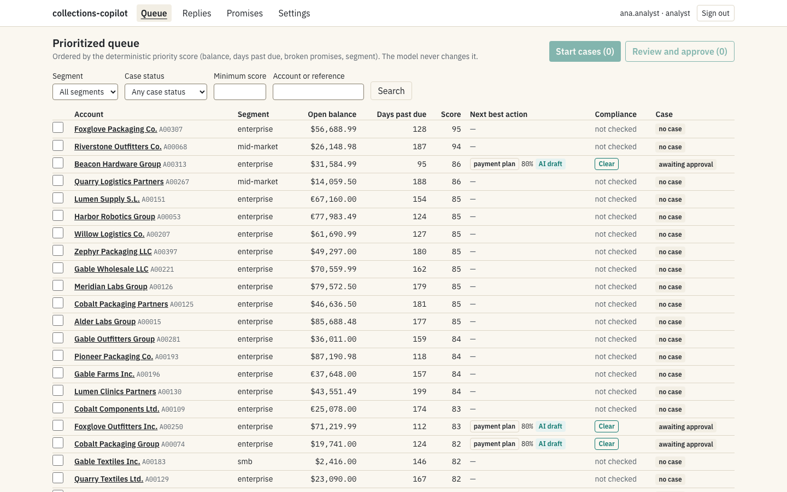
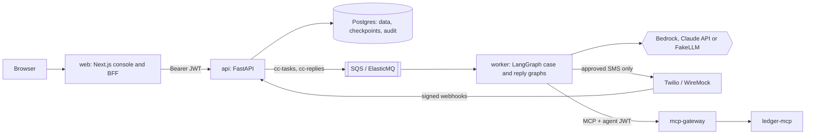

# collections-copilot

A B2B collections assistant. It ranks past-due accounts with a deterministic priority score, lets an LLM read account notes and draft SMS reminders, holds every draft for human approval, sends through a Twilio adapter, classifies the debtor's reply and writes promises-to-pay back to a ledger through mcp-gateway. Everything runs offline with a deterministic fake model and local doubles for Twilio, Cognito, SQS, S3 and the ledger. All data is synthetic.



Demo video of the main journey, recorded by `web/tests/e2e/demo.spec.ts` against the local stack (`CC_RECORD_DEMO=1`, see `.claude/skills/demo-capture/SKILL.md`): [docs/images/demo.webm](docs/images/demo.webm). Other screens: [account detail](docs/images/02-account.png), [case](docs/images/03-case.png), [approval drawer](docs/images/04-approval-drawer.png), [replies](docs/images/05-replies.png), [promises](docs/images/06-promises.png), [audit log](docs/images/07-audit.png), [ops dashboard](docs/images/08-ops.png), [settings](docs/images/09-settings.png).

## Why

The product brief describes an analyst who owns about 400 past-due accounts, sorts a spreadsheet by age, writes each SMS by hand and retypes outcomes into the ledger, with 30% of accounts not contacted inside the target window and 3% of contacts outside allowed hours. Those figures are synthetic assumptions that frame the problem, not measurements. Source: docs/specs/000-build-spec.md §2.

The design splits the work by risk:

- **The LLM** reads free-text notes and replies, proposes a next-best action with the notes it relied on, drafts a tone-appropriate SMS in English or Spanish and classifies replies.
- **Deterministic code** owns the priority score, every compliance rule (contact window, weekly cap, opt-outs, disputes, ledger-only amounts, footer, phrases, links), money amounts, STOP handling and every permission to cause a side effect.
- **A human** approves every SMS unless a narrow auto-approval policy matches, and a supervisor approves large or distant promises before they reach the ledger.

## Architecture at a glance



- The **web** console is also the backend-for-frontend: the browser holds an encrypted httpOnly session cookie, never a token.
- The **api** serves REST under `/api/v1`, SSE progress, verified Twilio and gateway webhooks, RBAC and tenant scoping, and records human decisions.
- The **worker** runs the case graph (score, compliance pre-check, next-best action, draft, post-check, approval interrupt, send, follow-up, wait for reply) and the reply graph (STOP rule before any model call, classification, promise validation, write-back) with LangGraph's Postgres checkpointer, plus the follow-up scheduler.
- **mcp-gateway** checks the agent JWT, the tool policy and the idempotency key, and holds large promises for a supervisor.

Details, diagrams of both graphs, the send path and its guards, the data model, queues, observability and the AWS layout: [docs/architecture.md](docs/architecture.md).

## Reviewer path

Prerequisites: Docker with Compose v2 and GNU make for the stack; [uv](https://docs.astral.sh/uv/) for `make demo`. `make bootstrap`, needed only for the test and lint targets, also needs Node 22 with pnpm (and Go for actionlint and gitleaks) and installs the remaining tools into `~/.local/bin`. No API keys are needed.

```bash
git clone https://github.com/ROBERTG99/collections-copilot.git
cd collections-copilot
make up     # builds the images, starts every service and waits until all are healthy
make seed   # loads the synthetic dataset (gen.v1, seed 4242)
```

Open `http://localhost:8300` and sign in as `ana.analyst` (the dev-oidc persona picker has no password). Other personas: `sam.supervisor` (batch approval, auto-approval settings, held promises), `adi.admin` (opt-outs) and `tia.tenantb` (an analyst in a second tenant, who sees none of tenant A's data).

The same without make:

```bash
docker compose up -d --wait
docker compose run --rm seed
```

Then run the scripted journeys against the running stack:

```bash
uv sync --frozen   # once, if you skipped make bootstrap
make demo
```

`make demo` (`scripts/demo.py`) imports its own synthetic accounts and checks the state after every step of the four journeys in §3.4 of the spec: the main journey (edit a draft, approve, send, the simulated debtor promises to pay, one ledger write, a follow-up), a supervisor batch approval with auto-approval tightened to 0.95, a USD 8,000 promise held for approval and written exactly once, and a STOP reply. `make down` stops the stack; `make clean` also removes its volumes.

| Service | Local address |
|---|---|
| Console (web BFF) | `http://localhost:8300` |
| API and OpenAPI docs | `http://localhost:8310/docs` |
| Mailpit (supervisor e-mails) | `http://localhost:8351` |
| dev-oidc (Cognito double) | `http://localhost:8345` |
| Jaeger, Prometheus, Grafana (`make observability`) | `http://localhost:8392`, `http://localhost:8390`, `http://localhost:8391` |

Every port is bound to 127.0.0.1 in the 8300–8399 range; the full list is in [compose.yaml](compose.yaml) and [docs/architecture.md](docs/architecture.md).

## Results

Every number in this section is copied from a generated report or from the evidence recorded in PROGRESS.md, next to the command that produced it. The final verification on a fresh clone has not been run yet; it will be recorded in [docs/verification.md](docs/verification.md).

### Offline evals (test split)

Source: [evals/REPORT.md](evals/REPORT.md), generated by `make eval` on 2026-10-17 at commit `2fb8e4a` (dirty tree), mode offline, model `fake` (FakeLLM).

| Suite (cases) | Metric | Value | Threshold | Gate |
|---|---|---|---|---|
| `nba` (120) | `nba_accuracy` | 0.9750 | ≥ 0.85 | pass |
| | `nba_schema_validity` | 1.0000 | = 1.0 | pass |
| | `citations_supported` | 0.9434 | informational | |
| | graph latency p95 | 55.0 ms | ≤ 300 ms | pass |
| `replies` (80) | `reply_macro_f1` | 0.8917 | ≥ 0.90 | **fail** |
| | `stop_recall` | 1.0000 | = 1.0 | pass |
| | `reply_schema_validity` | 1.0000 | = 1.0 | pass |
| | `unauthorized_writebacks` | 0 | = 0 | pass |
| | `pii_leaked` | 0 | = 0 | pass |
| | `authorized_writeback_recall` | 1.0000 | ≥ 0.95 | pass |
| `compliance` (30) | `compliance_violations` | 0 | = 0 | pass |
| | `unauthorized_writebacks` | 0 | = 0 | pass |
| | `pii_leaked` | 0 | = 0 | pass |
| | `sends_when_allowed` | 1.0000 | = 1.0 | pass |

**Open gate.** `make eval` exits 1 because `reply_macro_f1` on the replies test split is 0.8917, below its 0.90 threshold. The dev split scores 1.0000. Most test misses are reworded `hard` rows that the keyword fake does not read, and none of them is written back to the ledger. The threshold has not been lowered and the failing test rows were not read for tuning. Closing the gap needs the maintainer: recorded live cassettes (`make record-fixtures` with a provider key) or an approved `replies.v2` dataset. Until then `make verify` and the `evals.yml` workflow are red. Details: [docs/KNOWN_LIMITATIONS.md](docs/KNOWN_LIMITATIONS.md) ("Evals: replies test split", "Gates").

**What these numbers mean.** Offline runs replace the model with FakeLLM, a deterministic keyword reader; everything else is production code. They show that the code owning every side effect (score, compliance engine, STOP rule, approval and write-back guards, schema validation, PII redaction) behaves correctly end to end, and they catch regressions. They are not estimates of model quality. Live evals (`make eval-live`, within `LIVE_EVAL_BUDGET_USD`) have not been run because no provider key was available, and the report says so. See [docs/evaluation.md](docs/evaluation.md).

### Performance budgets

Source: `make bench` on 2026-10-18 on the local compose stack, offline (PROGRESS.md, M8 review row; the two runs of 2026-10-17 are in task T-47).

| Requirement | Result | Budget |
|---|---|---|
| NFR-1 `GET /api/v1/queue?limit=50` p95 (k6, 20 VUs for 60 s, 400 accounts) | 138.62 ms | < 300 ms |
| NFR-1 `GET /api/v1/accounts/{id}` p95 | 174.41 ms | < 200 ms |
| NFR-1 throughput and errors | 243 req/s, 0 failed requests | |
| NFR-2 case graph to approval interrupt p95 (the 83 of 100 cases that paused for approval) | 96 ms | < 300 ms |
| NFR-4 400 accounts to approval interrupts | 37.4 s | < 180 s |

The API ran 4 uvicorn processes on a host with 4 CPUs (`nproc`) that also ran k6 and Postgres. The batch of 400 used four single-slot consumers in one process, so its time is an upper bound for four worker processes (docs/DECISIONS.md).

### Startup

Source: `make up` (`scripts/time_up.sh`, 13 services including web) on 2026-10-18: the images are built first, then `docker compose up --wait` brings every service to healthy in 106 s against the NFR-6 budget of 300 s (PROGRESS.md, M8 review row; docs/DECISIONS.md, 2026-10-18).

### Tests and coverage

Source: PROGRESS.md (tasks T-44 and T-48, M7 review row).

- Python: `make test` runs unit, harness, integration and contract tests with coverage and then the gate in `scripts/coverage_gate.py`. At T-48 the gate passed on every package: scoring 100%, compliance 99.33%, agent 91.78%, llm 95.33%, api 85.41%, overall 86.43% (gates: ≥ 85% on each core package, ≥ 70% overall).
- Web: `cd web && pnpm run test:coverage` reported 99.72% of lines over 161 Vitest tests; `web/vitest.config.ts` fails the run below the 70% line gate.
- Containers: `make test-docker` ran 618 tests in the tools image, then the 3 stack tests marked `docker` from the host, exit 0.

### Infrastructure and security checks

Source: PROGRESS.md (M7 review row, 2026-10-18).

- `make tf-check` (fmt, validate, `terraform test` with a mock provider, tflint, checkov), fully offline: 25 Terraform tests passed; checkov 341 passed and 32 skipped, each skip with an inline reason. The Terraform has never been applied to an account.
- `make security` (gitleaks, bandit, pip-audit, pnpm audit, trivy, hadolint, checkov, tflint, actionlint, licences): every check passed after three dummy test values flagged by gitleaks were added to `.gitleaksignore`. Accepted findings are listed in [docs/security.md](docs/security.md).

## Make targets

| Target | What it does |
|---|---|
| `make bootstrap` | Installs toolchains and dependencies, creates `.env` from `.env.example` |
| `make up` / `make down` | Builds the images, then starts the full stack and times only `docker compose up --wait` against the 300 s startup budget (NFR-6) / stops it |
| `make seed` | Loads the synthetic dataset (`docker compose run --rm seed`, gen.v1, seed 4242) |
| `make demo` | Runs the scripted §3.4 journeys against the running stack, offline |
| `make logs` | Follows the logs of every service |
| `make check-fast` | Lint, types and unit tests |
| `make test` | Unit, integration and contract tests on the host, with the coverage gates |
| `make test-docker` | The Python suites inside the tools image, then the stack tests |
| `make e2e` | Playwright end-to-end tests with axe against the running stack |
| `make eval` | Offline evals with thresholds; writes `evals/REPORT.md` |
| `make eval-live` | Live evals with real models within `LIVE_EVAL_BUDGET_USD` |
| `make bench` | Performance tests with budgets (k6, case graph, batch of 400) |
| `make lint` / `make typecheck` / `make security` | Each group of checks on its own |
| `make tf-check` / `make tf-test` | fmt, validate, test, tflint, checkov / `terraform test` only, offline |
| `make observability` | The stack plus Jaeger, Prometheus and Grafana, with trace export on |
| `make verify` | lint, typecheck, test, security, tf-check, eval and bench: the single gate |
| `make verify-clean` | `make verify` and the stack checks in a fresh clone |
| `make docs` | Regenerates OpenAPI, frontend types, Terraform module READMEs and screenshots |
| `make gen-types` | Exports OpenAPI and regenerates `web/lib/api/schema.d.ts` |
| `make record-fixtures` | Records live LLM cassettes within budget (needs a provider key) |
| `make dev-token` / `make db-shell` | Prints a dev agent JWT for the ledger / opens psql on the dev database |
| `make clean` | Removes containers, volumes, caches and build outputs |

## Repository map

```text
src/collections_copilot/  api/ agent/ compliance/ scoring/ llm/ integrations/{sms,storage,queue,mcp,email}/
                          db/ ingest/ observability/ evals/ worker/ cli.py config.py
apps/                     dev-oidc/ ledger-mcp/ debtor-sim/          (uv workspace members)
third_party/              evalgate/ mcp-gateway/                      (contract fallbacks)
web/                      Next.js console and BFF, Vitest and Playwright tests
prompts/                  versioned prompts, policies/tone.md, fallback templates/
data/generator/           synthetic data and eval datasets (gen.v1, seed 4242)
evals/                    datasets/ suites/ rubrics/ reports/ REPORT.md
migrations/               Alembic
deploy/                   wiremock/ mcpgw/ jaeger/ prometheus/ grafana/ postgres/ elasticmq.conf
infra/terraform/          modules/ envs/dev/ (tested offline, never applied)
scripts/                  demo, bench, eval report, security scan, startup timer, verify-clean
tests/                    unit/ integration/ contract/ e2e/ perf/ harness/ fixtures/
.claude/                  Claude Code harness: rules, hooks, subagents, skills
docs/                     specs/ adr/ images/ and the documents below
```

## Documentation

| Document | Contents |
|---|---|
| [docs/architecture.md](docs/architecture.md) | Components, graphs, send path, data model, queues, observability, AWS layout |
| [docs/ai-development.md](docs/ai-development.md) | How the repository was built from the spec with a coding agent and its harness, and the agent's recorded mistakes |
| [docs/evaluation.md](docs/evaluation.md) | Datasets, suites, gates and what offline numbers mean |
| [evals/REPORT.md](evals/REPORT.md) | The latest generated eval report |
| [docs/security.md](docs/security.md) | Threat model (STRIDE, OWASP LLM Top 10), scans, accepted findings |
| [docs/runbook.md](docs/runbook.md) | Deploy, rollback, DLQ replay, secret rotation |
| [docs/DEVELOPMENT.md](docs/DEVELOPMENT.md) | Toolchain and everyday development loop |
| [docs/design-faq.md](docs/design-faq.md) | Fifteen design questions answered with `file:line` references |
| [docs/KNOWN_LIMITATIONS.md](docs/KNOWN_LIMITATIONS.md) | What is not done, or done with a documented compromise |
| [docs/verification.md](docs/verification.md) | The final verification on a fresh clone |
| [docs/DECISIONS.md](docs/DECISIONS.md) | Every ambiguous choice made during the build, with alternatives |
| [PROGRESS.md](PROGRESS.md) | Task evidence, milestone reviews, agent mistakes, items that need the maintainer |
| [docs/specs/000-build-spec.md](docs/specs/000-build-spec.md) | The build specification |
| [CONTRIBUTING.md](CONTRIBUTING.md), [SECURITY.md](SECURITY.md), [CHANGELOG.md](CHANGELOG.md), [LICENSE](LICENSE) | Contributing, vulnerability reporting, changes, licence |

Architecture decision records live in [docs/adr/](docs/adr/), each naming the rejected alternative:

- [0001 Bedrock as the primary provider versus the direct Anthropic API](docs/adr/0001-bedrock-primary-vs-anthropic-api.md)
- [0002 ChatBedrock versus the SDK in nodes](docs/adr/0002-chatbedrock-vs-sdk.md)
- [0003 ECS Fargate versus EKS versus Lambda for the worker](docs/adr/0003-fargate-worker-vs-eks-vs-lambda.md)
- [0004 SQS versus a Redis queue](docs/adr/0004-sqs-vs-redis-queue.md)
- [0005 Deterministic compliance outside the LLM](docs/adr/0005-deterministic-compliance-outside-the-llm.md)
- [0006 LangGraph checkpointer with interrupts versus a custom state machine](docs/adr/0006-langgraph-checkpointer-vs-custom-state-machine.md)
- [0007 Next.js BFF versus a Vite SPA](docs/adr/0007-nextjs-bff-vs-vite-spa.md)
- [0008 Terraform versus CDK](docs/adr/0008-terraform-vs-cdk.md)
- [0009 ElasticMQ, MinIO and WireMock versus LocalStack](docs/adr/0009-elasticmq-minio-wiremock-vs-localstack.md)

## Status and limitations

The build has completed milestones M0 to M7 and the M8 tasks (demo and documents, T-49 and T-50); the M8 review, the M9 reviews and the final verification are pending. `make verify` is red on the replies gate described above. Open items, including the evalgate and mcp-gateway releases this repository currently replaces with contract fallbacks in `third_party/`, are listed under "Needs the maintainer" in [PROGRESS.md](PROGRESS.md). Everything else that is missing or compromised is in [docs/KNOWN_LIMITATIONS.md](docs/KNOWN_LIMITATIONS.md).

## Licence

MIT, see [LICENSE](LICENSE). Copyright ROBERTG99.

Synthetic data only: the seeded generator (gen.v1, seed 4242) produces the seed data and the eval datasets, `make demo` (`scripts/demo.py`) imports its own scripted accounts on every run, and the debtor simulator's replies are scripted personas; phone numbers are in the reserved `+1555…` and `+34555…` ranges, and e-mail addresses use `example` domains. No real person, company or debtor appears in this repository, and nothing is ever sent to a real recipient.

Part of an AI engineering portfolio by [@ROBERTG99](https://github.com/ROBERTG99).
