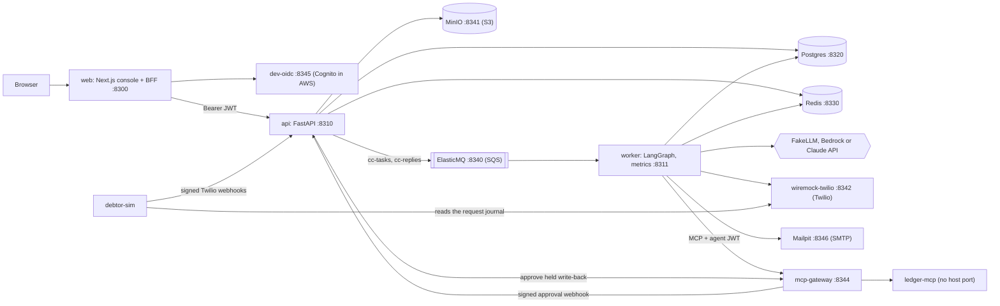
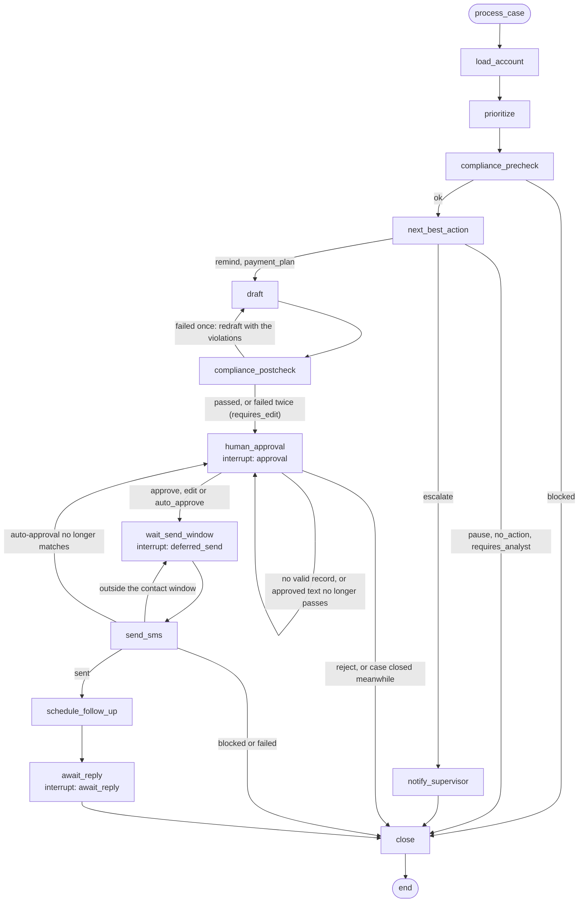
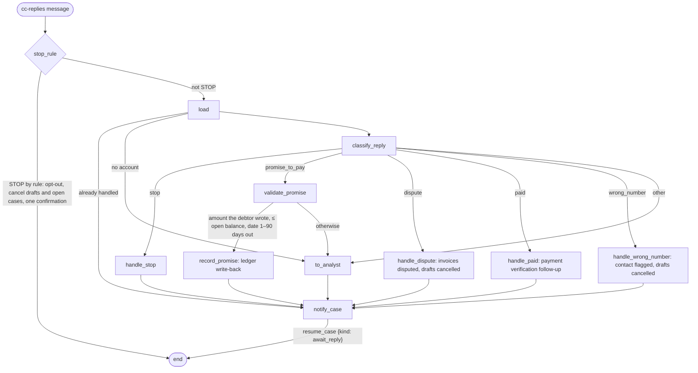
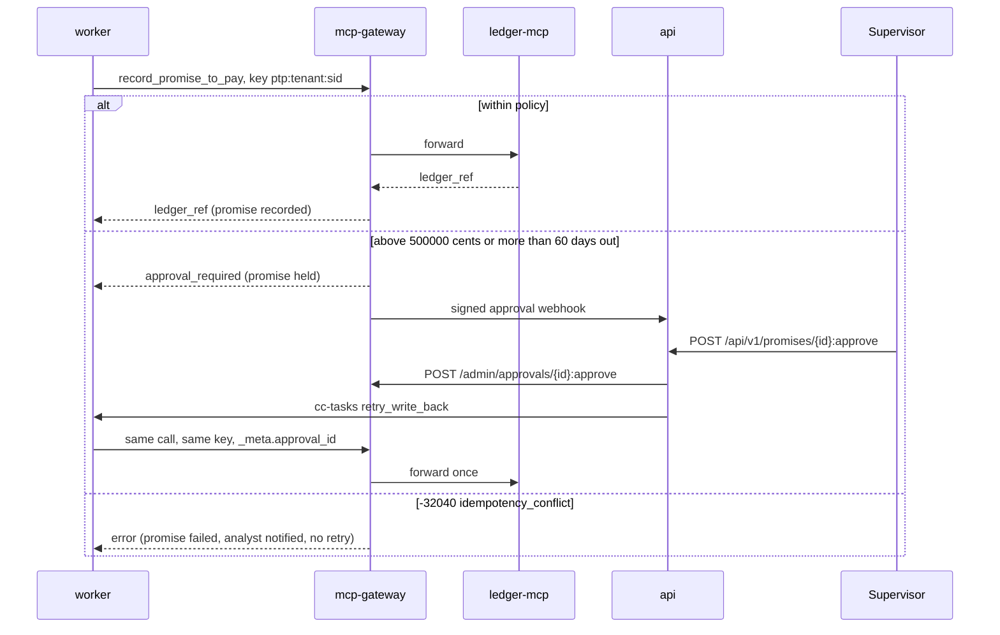
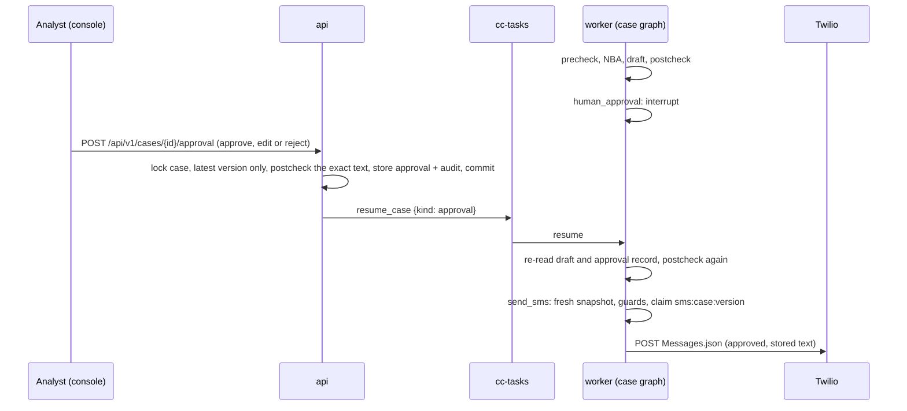
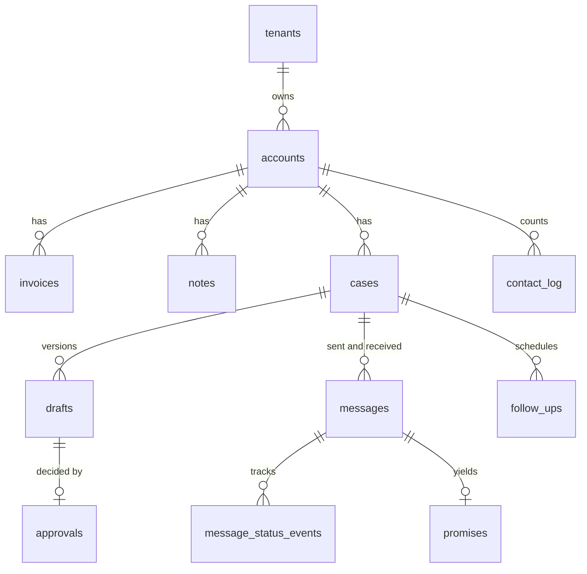
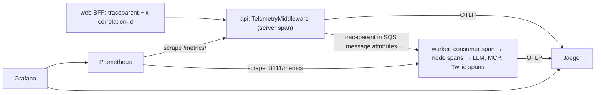
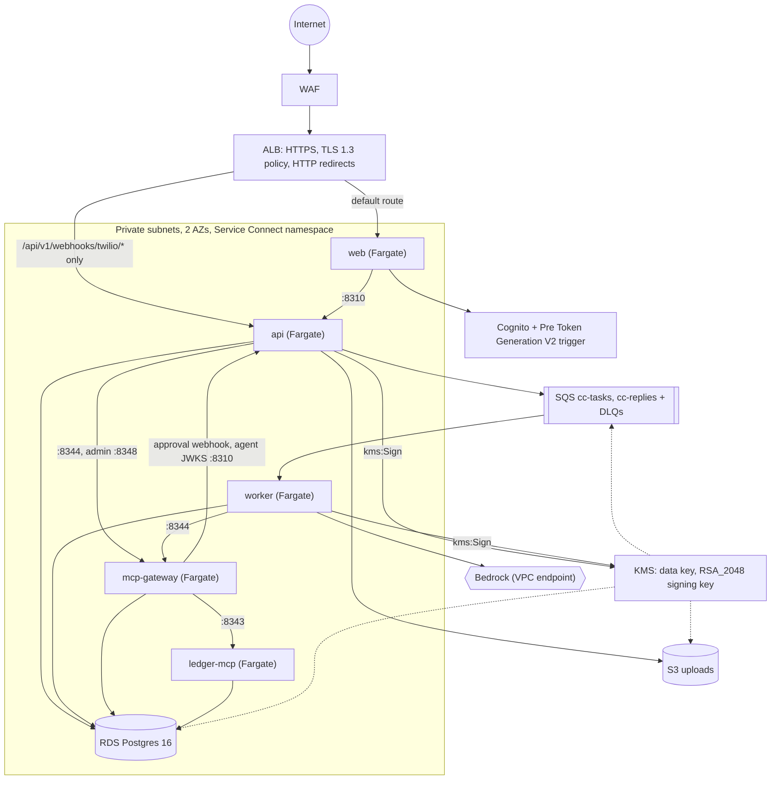

# Architecture

How collections-copilot is put together: the services and their ports, the two LangGraph graphs, the path an SMS takes and every guard on it, the data model and tenancy, queues and the worker, observability, and the AWS layout in `infra/terraform`. The specification is [docs/specs/000-build-spec.md](specs/000-build-spec.md) §4; choices made during the build are in [docs/DECISIONS.md](DECISIONS.md) and the ADRs in [docs/adr/](adr/).

## Principles

- **Deterministic code owns every decision with a side effect.** The priority score, the compliance engine, money amounts, STOP handling, auto-approval and every permission to send or write are plain Python with property tests. The model reads notes and replies and writes text; it has no tools and its output is limited to enumerated actions and schema-validated fields.
- **Nothing is trusted from the checkpoint at send time.** The worker re-reads the case, the draft, its approval record and the debtor's facts from Postgres immediately before sending.
- **Every side effect has an idempotency key** stored before the effect: `sms:<case_id>:<draft_version>` for an SMS, `ptp:<tenant>:<MessageSid>` for a promise write-back, `stop:<tenant>:<phone>` for a STOP confirmation, `esc:<case_id>` for a supervisor escalation.
- **Offline first.** Every external system has a local double, and the model is FakeLLM unless `CC_LLM_PROVIDER` says otherwise.

## Components and ports

Local services from [compose.yaml](../compose.yaml). Every host port is bound to `127.0.0.1` in the 8300–8399 range, and every long-running service has a healthcheck that its dependents wait on.

| Service | Host port | Role |
|---|---|---|
| `web` | 8300 | Next.js console and backend-for-frontend. Holds the session in an encrypted httpOnly cookie, proxies `/api/*` and SSE to the API with the access token, so the browser never sees a token. Its BFF answers 404 for `/api/webhooks/*`. |
| `api` | 8310 | FastAPI: REST under `/api/v1`, SSE, Twilio and gateway webhooks, RBAC, ingest, approval decisions, settings, ops metrics, audit, `/.well-known/agent-jwks.json`, Prometheus at `/metrics/`. Runs `CC_API_WORKERS` uvicorn processes (4 in compose). |
| `worker` | 8311 (health and metrics) | SQS consumers for `cc-tasks` (case graph) and `cc-replies` (reply graph), the follow-up scheduler and the DLQ depth gauge. |
| `postgres` | 8320 | Application tables, LangGraph checkpoints (schema `checkpoints`), the ledger double (schema `ledger`) and the gateway's state. |
| `redis` | 8330 | SSE event streams, rate limits, `Idempotency-Key` results. |
| `elasticmq` | 8340 | SQS double: `cc-tasks`, `cc-replies` and their DLQs ([deploy/elasticmq.conf](../deploy/elasticmq.conf)). |
| `minio` | 8341, console 8347 | S3 double for presigned CSV uploads. |
| `wiremock-twilio` | 8342 | Twilio `Messages.json` double ([deploy/wiremock/](../deploy/wiremock/)). |
| `ledger-mcp` | none | Synthetic ledger, an MCP server over Streamable HTTP. It trusts the tenant the gateway passes in `_meta`, so only the gateway may reach it. |
| `mcp-gateway` | 8344, admin 8348, dev issuer 8349 | Contract fallback in `third_party/mcp-gateway`: agent JWT, tool policy ([deploy/mcpgw/policy/collections.yaml](../deploy/mcpgw/policy/collections.yaml)), idempotency, approvals, audit. |
| `dev-oidc` | 8345 | Cognito double with the personas `ana.analyst`, `sam.supervisor`, `adi.admin` and `tia.tenantb`. |
| `mailpit` | SMTP 8346, UI 8351 | Supervisor e-mail double. |
| `debtor-sim` | none | Demo only: reads the WireMock journal and posts signed status callbacks and scripted persona replies. |
| `migrate`, `seed` | none | One-shot jobs: `alembic upgrade head`; `cc seed` (profile `jobs`, run with `docker compose run --rm seed`). |
| `jaeger`, `prometheus`, `grafana` | 8380/8381 (OTLP), 8392 (UI); 8390; 8391 | Profile `observability`, started by `make observability`. |

## Case graph

`src/collections_copilot/agent/case_graph.py`. State `CaseState`; checkpointer `AsyncPostgresSaver` in schema `checkpoints` with `thread_id = case_id` (`agent/checkpointer.py`). The graph pauses at three interrupts and is resumed with `Command(resume=...)`.

| Node | What it does |
|---|---|
| `load_account` | Loads the account, invoices, notes, opt-out, recent contacts and the tenant's auto-approval policy; sets the case `processing`. |
| `prioritize` | Deterministic score (`scoring/priority.py`, below); the model only writes `prioritize_rationale`, which is null when the model fails. |
| `compliance_precheck` | Opt-out, contact flag, weekly cap and fully disputed accounts before any model call; a blocked case closes. Outside the contact window the check computes a deferred send time instead of blocking. |
| `next_best_action` | `remind`, `payment_plan`, `escalate`, `pause` or `no_action`, with confidence and cited note ids. The model is called only when notes exist, else `agent/nba_rules.py` decides; invalid output twice ends with `requires_analyst` (`nba_invalid_output`); a provider outage falls back to the rules, labelled `fallback`. |
| `notify_supervisor` | E-mail with key `esc:<case_id>`, audit event, close. |
| `draft` | SMS of at most 320 characters in the account language from `draft_message.v1` and `prompts/policies/tone.md`; templates on refusal or outage (author `fallback`). A re-run after a crash reuses the stored draft row, so the approved text is always the stored text. |
| `compliance_postcheck` | The full rule set on the draft text. One redraft with the violations as feedback; a second failure reaches a human with `requires_edit`. |
| `human_approval` | Applies the auto-approval policy on facts read now; otherwise sets `awaiting_approval`, schedules a 24-hour reminder and calls `interrupt()`. After the resume it ignores the payload's text: it re-reads the latest draft and the approval record stored by the API and re-runs the post-check on that text. |
| `wait_send_window` | If the approved send time is in the future, schedules a `deferred_send` follow-up, sets `scheduled` and interrupts. |
| `send_sms` | The last set of guards (next section), then the provider call. |
| `schedule_follow_up` | `after_send` follow-up in 3 business days. |
| `await_reply` | Sets `awaiting_reply` and interrupts until the reply graph or the scheduler resumes it. |
| `close` | `closed`, or `failed` after a failed send; audit event. A closed or failed case is final: no node can reopen it (`CasesRepo.set_unless_closed`). |

Every node is wrapped to record a step record, a tracing span, the `cc_node_duration_seconds` histogram and SSE `node` events. Nodes are idempotent because LangGraph re-runs an interrupted or crashed node from its start.

`worker/runner.py` applies queue messages to the graph. `process_case` starts the graph when no checkpoint exists, continues from the last checkpoint after a crash and ignores a duplicate. `resume_case` and `follow_up` resume only when the graph is paused at an interrupt of the kind the message names (`approval`, `deferred_send`, `await_reply`); anything else is a stale or duplicate delivery and is ignored. Each case runs under a Postgres advisory lock held for the whole run, so two deliveries of one case never interleave.

## Reply graph

`src/collections_copilot/agent/reply_graph.py`. It runs without a checkpointer: a reply has no human pause, and its state lives in the `messages` and `promises` rows. Each handler applies its side effects and marks the inbound message `handled` in one transaction, and a classification already stored is reused on redelivery, so nothing happens twice.

- **STOP never reaches the model.** `compliance/stop_keywords.py` handles whole-message keywords, unsubscribe phrases and explicit requests to stop contacting in English and Spanish. The Twilio inbound webhook applies the same rule before anything is queued, and a STOP applies in every tenant that texted or holds the number, with one confirmation SMS. The confirmation is the only SMS sent without an approval record; it comes from a fixed template with key `stop:<tenant>:<phone>`.
- **The model may label a reply `stop` too**; `handle_stop` then applies the same opt-out.
- **Only `validate_promise` leads to a write-back** (`may_write_back`), and only for an amount that appears in the debtor's text, within the open balance, with a date 1 to 90 days out.

### Promise write-back

`agent/nodes/record_promise.py` creates the `promises` row (unique key `ptp:<tenant>:<MessageSid>`) before calling `ledger.record_promise_to_pay` through mcp-gateway with that key in `params._meta.idempotency_key`. The gateway replays the stored result for a repeated key, so a crash after the call and a redelivery still produce one ledger row. If the gateway is unavailable (or the first call with the key is still in progress), the promise stays open and a `promise_write_back` follow-up retries the same key with back-off (2 to 64 minutes, six times), after which the promise fails and a supervisor is told.

The approval webhook is signed over `{timestamp}.{body}` (`X-MCPGW-Timestamp`), old timestamps are refused and replays are detected under a row lock. Agent JWTs carry `aud=mcp-gateway`, a subject (`cc-worker` with `ledger:read`/`ledger:write` for ledger calls, `cc-api` with `mcpgw:approve` for a supervisor's promise approval) and the tenant, and expire within 5 minutes; locally the gateway's dev issuer mints them, in AWS they are signed with the KMS signing key and verified against the API's `/.well-known/agent-jwks.json`.

## The send path and its guards

An SMS is sent from exactly one place, `send_sms` in the case graph. The STOP confirmation is the only other outbound message. `tests/integration/test_no_send_without_approval.py` checks that these are the only callers of the SMS provider and that a resume without an approval record sends nothing.

Guards, in the order the text meets them:

1. **Pre-check** (`compliance/engine.py`) before any model call: opt-out list, wrong-contact flag, at most 3 contacts per account in a rolling 7 days, and no case when every unpaid invoice is disputed. The contact window is 08:00–21:00 debtor local time (new sends stop at 20:50); outside it the send time moves to the next opening rather than blocking.
2. **Post-check** on every draft and every edit: the pre-check rules plus the text rules: length, amounts (every number must be an invoice number, date, identifier, small count or the account name, or equal an open invoice amount or the open total, so a disputed invoice's amount cannot appear), the opt-out footer, forbidden phrases, a link allowlist, NFKC normalisation, and no invisible characters or non-Latin letters. Amount and link rules fail closed. The console calls `POST /api/v1/cases/{id}/postcheck` as the analyst types; approval is enabled only for text that was checked.
3. **Approval record** for the exact draft version. The API (`api/routers/approvals.py`) locks the case, accepts a decision only for the latest version of a case awaiting approval, re-runs the post-check on the exact text (the edited text for an edit), stores the approval with the edit diff and an audit event, commits, and only then enqueues `resume_case`. Batch approval takes at most 50 items, each checked the same way.
4. **Auto-approval** (`agent/policy.py`) replaces the human only when every condition holds: action `remind`, open balance at most `CC_AUTO_APPROVE_MAX_USD` (USD 500 by default) with a known currency, model confidence at least `CC_AUTO_APPROVE_MIN_CONFIDENCE` (0.9 by default), a decision that came from the model and not from rules or a fallback, the deterministic house rules choosing a reminder for the same facts, a clean post-check, and no `requires_edit`. Supervisors can only tighten the policy. The policy is evaluated again at send time; if it no longer matches, the draft goes back to a human as a new version.
5. **Send-time snapshot** (`agent/store.py`, `send_snapshot`): case not closed, draft not cancelled, an approval record for this version, and the post-check again on the stored body with the debtor's current invoices, opt-out, contacts and contact flag. Outside the window the send is deferred to the next allowed time with a `deferred_send` follow-up.
6. **Claim before the call.** The `messages` row with key `sms:<case_id>:<draft_version>` is inserted under a lock on the case row, re-checking that the case is open and the number is not opted out, so a STOP that lands meanwhile wins.
7. **At most once.** Twilio is retried only after connect errors, 429 or 503. A read timeout, another 5xx or a crash after the claim means the outcome is unknown: the message is marked failed, never resent, counted toward the weekly cap, and a `send_retry` follow-up e-mails the supervisor.

## Data model and tenancy

SQLAlchemy 2 models in `src/collections_copilot/db/models.py`, migrations in `migrations/versions/` (`0001_initial`, `0002_account_priority_cache`).

| Table | Notes |
|---|---|
| `tenants`, `accounts`, `invoices`, `notes` | Accounts carry the cached priority score and its components (refreshed on ingest, seed, broken promises and daily); invoices are integer cents plus currency, `amount_cents > 0`. |
| `ingest_batches` | Unique per tenant on the file's SHA-256, so a re-upload returns the first batch. |
| `cases` | `id` is the LangGraph `thread_id`; at most one open case per account (partial unique index). |
| `drafts`, `approvals` | One row per draft version; one approval per draft with decision, reason, diff, actor and a policy snapshot. |
| `messages`, `message_status_events` | Unique `provider_sid` and unique `idempotency_key`; status callbacks are unique on `(provider_sid, status)`. |
| `promises` | Unique `idempotency_key` (`ptp:<tenant>:<MessageSid>`), gateway approval id and `ledger_ref`. |
| `follow_ups`, `opt_outs`, `contact_log` | Scheduler work, the opt-out list keyed by `(tenant_id, phone_e164)`, and sends counted for the weekly cap. |
| `settings`, `step_records` | Per-tenant settings such as the auto-approval policy; one step record per node and model call. |
| `audit_events` | Append-only (a trigger rejects UPDATE, DELETE and TRUNCATE), SHA-256 hash-chained per tenant; `cc audit verify` reports the first bad sequence number. |
| `api_idempotency` | Present in the schema; `Idempotency-Key` results are kept in Redis instead (docs/DECISIONS.md). |

Tenancy:

- Every table has `tenant_id`. The tenant comes from the verified access token (`custom:tenant_id`, roles from `cognito:groups`; `api/deps/auth.py`), never from the request body.
- All data access goes through `db/repositories/*`, bundled per unit of work in `Repos`; every method takes the tenant as its first argument and filters on it. Raw SQL (`sqlalchemy.text`) is banned outside `collections_copilot.db` by a ruff rule (TID251).
- A tenant-A token asking for a tenant-B id gets 404, checked over every route by the RBAC matrix test.
- Child tables reference parents by `id` only, without composite `(tenant_id, id)` keys; see [docs/KNOWN_LIMITATIONS.md](KNOWN_LIMITATIONS.md).
- Money is `bigint` cents plus a currency code everywhere; times are `timestamptz`, and debtor-local times use `zoneinfo`.

## Queues and the worker

| Queue | Message | Producers |
|---|---|---|
| `cc-tasks` | `cc.task.v1`: `process_case`, `resume_case`, `follow_up`, `retry_write_back` | API (new cases, approvals, promise approvals), scheduler, reply graph |
| `cc-replies` | `cc.reply.v1`: tenant, message id, provider SID, sender, body | Twilio inbound webhook, scheduler (re-enqueues replies still `received`) |
| `cc-tasks-dlq`, `cc-replies-dlq` | Messages received 5 times without success | SQS redrive |

Locally the visibility timeout is 60 seconds and receives long-poll for 20 seconds (Source: deploy/elasticmq.conf). `worker/consumer.py` receives up to `CC_WORKER_CONCURRENCY` (8) messages per queue at a time, extends visibility while a handler runs, deletes a message only after its handler succeeded and otherwise leaves it to be redelivered and eventually dead-lettered. The API enqueues only after its transaction commits, and `POST /api/v1/cases` answers 503 with `Retry-After` when the queue is unavailable.

The worker process (`worker/main.py`) runs, side by side:

- the two consumers: case tasks through `CaseRunner` under a per-case advisory lock, replies through the reply graph under a per-reply advisory lock;
- the scheduler (`agent/scheduler.py`), led by one worker at a time through a Postgres advisory lock (`LeaderLock`). Each tick claims due follow-ups with `FOR UPDATE SKIP LOCKED`: deferred sends, no reply after 3 business days, promises due (kept or broken, a broken one opens a new case), approval reminders after 24 hours, unknown send outcomes and payment verifications. Failing rows back off and are cancelled after 5 attempts;
- a DLQ watcher that keeps `cc_sqs_dlq_depth` current;
- a small HTTP server with `/healthz` and `/metrics`.

Live progress: graph nodes publish `node`, `draft` and `status` events to a Redis stream per case (`cc:events:<tenant>:<case_id>`, at most 200 entries). `GET /api/v1/cases/{id}/events` reads that stream for both live delivery and `Last-Event-ID` resume, sends heartbeats, and ends when the access token expires.

## LLM layer

Only `collections_copilot.llm` imports provider SDKs (import-linter); a second contract keeps `scoring` and `compliance` independent of `llm` and `agent`. `llm/gateway.py` selects the provider (`fake`, `bedrock`, `anthropic`), applies the per-route model (`CC_MODEL_FAST` and `CC_MODEL_REASONING`, or `CC_BEDROCK_MODEL_FAST` and `CC_BEDROCK_MODEL_REASONING` with the `bedrock` provider), a timeout, retries only on 408, 409, 429, 5xx and connection errors, a circuit breaker, refusal and `max_tokens` handling, and schema validation with one corrective retry before the deterministic fallback. `llm/redaction.py` removes the account's name and phone, other phone numbers, e-mails, cards and IBANs before any provider call. Prompts are versioned files in `prompts/`; notes and replies appear only inside `<untrusted_note>` blocks after the instructions, and every call records the prompt version and hash, model, tokens, cost, latency and outcome as a step record. ADR [0002](adr/0002-chatbedrock-vs-sdk.md) records why nodes use the SDK client rather than ChatBedrock.

## Observability

- **Traces.** The BFF starts each request with a W3C `traceparent` and a correlation id; the API's `TelemetryMiddleware` continues it, and the trace context travels through SQS message attributes into the worker, where each graph node and each LLM, MCP and Twilio call gets a span. LLM spans carry `gen_ai.*` attributes (provider, request model, input and output tokens) plus the prompt version and hash. Every span is opened through `observability/tracing.py`, which records only the exception type, never its message or stack, so phone numbers and reply text cannot reach exported spans; an interrupt is not an error. Export is on when `CC_OTEL_EXPORTER_OTLP_ENDPOINT` is set, as `make observability` does.
- **Logs.** JSON lines from `observability/logging.py` with `correlation_id`, `trace_id`, `tenant_id` and `case_id`. Phone numbers (E.164, national and URL-encoded), e-mails, JWTs, bearer headers and API keys are masked in messages, extra fields and exception text; body, recipient and authorization fields are dropped. uvicorn's access log is off; the middleware logs one line per request with the route template.
- **Metrics** (`observability/metrics.py`): `cc_http_request_duration_seconds`, `cc_node_duration_seconds`, `cc_llm_tokens_total`, `cc_llm_cost_usd_total`, `cc_nba_decisions_total{action}`, `cc_approvals_total{decision}`, `cc_sms_sent_total{status}`, `cc_sqs_dlq_depth`. Labels carry identifiers with bounded cardinality, never tenant data. The API runs Prometheus multiprocess mode across its uvicorn processes.
- **Local stack** (profile `observability`, [deploy/](../deploy/)): Jaeger v2 as the OTLP receiver and UI, Prometheus with the scrape configuration and alert rules `CCDLQNotEmpty`, `CCQueueLatencyP95High` and `CCApiErrorRateHigh` (`deploy/prometheus/`), and Grafana with the provisioned `collections` dashboard (`deploy/grafana/dashboards/collections.json`).
- **Ops dashboard in the console.** `GET /api/v1/metrics/ops` serves the FR-14 cards (cases by status, contact-window rate, pending approvals, cost per account, node p95, DLQ depth) from the database and the queues.

## AWS layout

`infra/terraform` (modules plus `envs/dev`) describes the production shape. It is validated and tested offline with `mock_provider` (`make tf-check`) and has never been applied to an account.

- **Edge.** The ALB terminates TLS with an ACM certificate and redirects HTTP. Its only path rule sends `/api/v1/webhooks/twilio/*` to the API; everything else goes to the web BFF, which proxies `/api/*`. The gateway's approval webhook never leaves the VPC. A WAF with the AWS common and known-bad-inputs rule sets, a per-IP rate rule for the console and a separate one for the Twilio webhook path sits in front, with Authorization and Cookie headers redacted from its logs. The API trusts `X-Forwarded-For` only from the public subnets the load balancer runs in. `tests/harness/test_terraform_wiring.py` checks the route prefix, the served paths and every `CC_*`, `MCPGW_*` and `WEB_*` variable name against the code.
- **Compute.** One ECS cluster with five Fargate services (api, worker, web, ledger-mcp, mcp-gateway) in private subnets without public IPs, each with its own execution and task roles, read-only root filesystem and UID 10001. Service-to-service traffic uses a Service Connect namespace, and each internal path is its own security-group rule: web → api, api → mcp-gateway (MCP and the admin approvals port), worker → mcp-gateway, mcp-gateway → ledger-mcp, and mcp-gateway → api for its approval webhook and the agent JWKS. The worker scales on CPU and on the `cc-tasks` backlog per running task, up to `worker_max_tasks`; the API and web scale on CPU. Each API task runs one process and the service scales out by tasks.
- **Identity.** Cognito user pool (Essentials tier, MFA, groups analyst, supervisor and admin, immutable `custom:tenant_id`) with a public PKCE client for the console. Cognito puts custom attributes only in ID tokens, and the API accepts access tokens only, so a Pre Token Generation V2 Lambda (`modules/cognito/lambda/pre_token.py`) copies `custom:tenant_id` into the access token and refuses users without a tenant.
- **Keys.** KMS holds a rotating data key, used for RDS, S3, every SQS queue, Secrets Manager, CloudWatch log groups, SNS and ECR, and an RSA_2048 signing key for agent JWTs. Only the api and the worker may call `kms:Sign`, and only with `RSASSA_PKCS1_V1_5_SHA_256` (RS256). `bedrock:InvokeModel` is allowed only on the configured `anthropic.` model ids.
- **Data.** RDS Postgres 16 in private subnets, KMS-encrypted, with 7-day backups, a managed master password and log groups created up front with KMS and 30-day retention. The S3 uploads bucket is versioned, SSE-KMS, TLS-only and blocks public access; uploads expire after 30 days. Secrets Manager entries are created empty and filled out of band ([docs/runbook.md](runbook.md)).
- **Network.** VPC over two availability zones, one NAT gateway, interface endpoints for Bedrock runtime, SQS, Secrets Manager, ECR, CloudWatch Logs and KMS, and an S3 gateway endpoint. Egress is limited per service: ledger-mcp and mcp-gateway reach only the database, their peers and the S3 prefix list.
- **Operations.** Per-service KMS log groups with 30-day retention, an SNS alarm topic, alarms for any message in a DLQ, the age of the oldest message in each queue and the ALB 5xx rate, and a monthly budget. A GitHub OIDC role for `main` may only plan: read-only access with explicit denies on data reads. No workflow applies.

Known gaps of this layout (no ElastiCache module, ALB access logs off by default, SMTP without authentication, an unverified Service Connect endpoint question) are listed in [docs/KNOWN_LIMITATIONS.md](KNOWN_LIMITATIONS.md); deploy and rollback steps are in [docs/runbook.md](runbook.md).

## Priority score (FR-2)

The priority score is computed by `src/collections_copilot/scoring/priority.py` (`priority.v1`). It is deterministic, bounded to 0–100 and non-decreasing in balance, days past due and broken promises. The LLM only writes an explanatory rationale (`prioritize_rationale.v1`) and never changes the number.

| Component | Points | Formula |
|---|---|---|
| Balance | 0–40 | `40 × min(1, log10(1 + balance_usd) / log10(1 + 50 000))` over open invoices only |
| Days past due | 0–35 | `35 × min(1, max_dpd / 120)` over open invoices only |
| Broken promises | 0–15 | `15 × min(3, broken promises with a due date in the last 90 days) / 3` |
| Segment | 3, 6 or 10 | smb 3, mid_market 6, enterprise 10 |

`score = round(sum of components)`, clamped to 0–100. EUR balances use the fixed scoring rate 1.08 (scoring only; amounts shown to debtors always come from the ledger in their own currency). Properties are tested with Hypothesis in `tests/unit/scoring/test_priority.py`.
